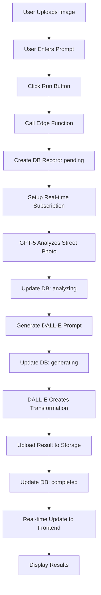

# AI City Planner - Street Vision Documentation

## Overview

The AI City Planner (accessible at `/aicityplanner`) is a sophisticated web application that transforms street photographs into AI-generated visions of safer, more livable urban spaces. It uses advanced AI models including GPT-5 for scene analysis and DALL-E for image generation to create compelling before/after comparisons.

## 🏗️ Architecture

### Frontend Components
- **Main Page**: `src/pages/AICityPlanner.tsx` - Orchestrates the entire workflow
- **Upload Component**: `src/components/ai-city-planner/ImageUploadArea.tsx` - Handles drag/drop image uploads
- **Prompt Input**: `src/components/ai-city-planner/PromptInput.tsx` - User vision description interface  
- **Results Display**: `src/components/ai-city-planner/StreetVisionResults.tsx` - Shows transformation results
- **Image Lightbox**: `src/components/ai-city-planner/ImageLightbox.tsx` - Fullscreen comparison viewer

### Backend Services
- **Edge Function**: `supabase/functions/street-vision-agent/index.ts` - AI processing orchestrator
- **Database**: `street_vision_generations` table - Tracks processing state and results
- **Storage**: Supabase storage bucket `street-vision` - Stores original and transformed images

### State Management
- **Custom Hook**: `src/hooks/useStreetVisionProcessing.ts` - Manages processing lifecycle with real-time updates

## 🔄 Workflow

### 1. Image Upload Phase
- User drags/drops or selects a street photograph
- Image is uploaded to Supabase storage in `street-vision` bucket
- Frontend gets public URL for immediate display
- Upload state managed with loading indicators

### 2. Prompt Input Phase  
- User describes their vision for street transformation
- Examples: "Add bike lanes and greenery" or "Make it more pedestrian-friendly"
- Input validation ensures prompt is provided before processing

### 3. AI Processing Phase
**Initiated by**: `handleRun()` function calling `startProcessing()`

**Edge Function Workflow**:
1. Creates database record with status `pending`
2. **GPT-5 Vision Analysis**: Analyzes uploaded street photo to understand current conditions
3. **Prompt Generation**: Creates detailed DALL-E prompt based on user vision and street analysis
4. **DALL-E Generation**: Generates transformed street image using optimized prompt
5. **Storage Upload**: Saves transformed image to Supabase storage
6. **Database Update**: Updates record with results and status `completed`

**Real-time Updates**: Frontend receives live status updates via Supabase real-time subscriptions

### 4. Results Display Phase
- Shows original vs transformed images side-by-side
- Displays processing metrics (analysis time, generation time)
- Provides download options for both images
- Includes fullscreen lightbox for detailed comparison

## 📊 Database Schema

### `street_vision_generations` Table
```sql
- id: uuid (primary key)
- user_id: uuid (references auth.users)
- user_prompt: text (user's transformation vision)
- original_image_url: text (Supabase storage URL)
- transformed_image_url: text (generated image URL)
- original_filename: text (user reference)
- status: text (pending, analyzing, generating, completed, failed)
- vision_analysis: text (GPT-5 scene analysis)
- image_generation_prompt: text (optimized DALL-E prompt)
- prompt_model: text (AI model used for analysis)
- image_model: text (AI model used for generation)
- processing_time_ms: integer (total processing duration)
- error_message: text (failure details if applicable)
- created_at: timestamp
- updated_at: timestamp
```

## 🔄 Real-time Processing Flow



## 🛠️ Key Features

### Real-time Processing Updates
- **Supabase Channels**: Live status updates without polling
- **Fallback Polling**: Ensures updates even if real-time fails
- **Status Progression**: `pending` → `analyzing` → `generating` → `completed`/`failed`

### Error Handling & Retry
- Comprehensive error messages for each failure point
- Retry functionality that clears state and re-initiates processing
- Toast notifications for user feedback throughout workflow

### Image Management
- **Storage Integration**: Automatic upload/download from Supabase storage
- **Public URLs**: Secure access to images via Supabase CDN
- **File Organization**: User-specific folders with timestamp-based naming

### Performance Optimization
- **Memory Management**: Automatic cleanup of subscriptions and polling
- **Component Optimization**: Conditional rendering based on processing state
- **Image Loading**: Progressive loading states with skeleton screens

## 🔧 Technical Implementation Details

### Authentication
- Requires user authentication for all operations
- JWT tokens automatically handled by Supabase client
- User-specific storage paths and database records

### AI Model Configuration
- **Vision Analysis**: GPT-5 (`gpt-5-2025-08-07`) for scene understanding
- **Image Generation**: DALL-E 3 for high-quality transformations
- **Prompt Optimization**: Custom prompts optimized for urban planning context

### Storage Configuration
```typescript
// Storage bucket: 'street-vision'
// File structure:
// ├── {user_id}/
//     ├── originals/
//     │   └── {timestamp}_{filename}
//     └── transformed/
//         └── {record_id}_transformed.png
```

### Error Recovery
- **Network Failures**: Automatic retries with exponential backoff
- **Processing Failures**: Detailed error messages with suggested actions
- **State Corruption**: Full state reset with cleanup functionality

## 🚀 Getting Started

### Prerequisites
- Supabase project with authentication enabled
- OpenAI API key configured in edge function secrets
- `street-vision` storage bucket created with public access

### Environment Setup
1. Ensure Supabase client is configured in `src/integrations/supabase/client.ts`
2. Edge function deployed with OpenAI API key secret
3. Database table `street_vision_generations` exists with RLS policies

### Usage Flow
1. Navigate to `/aicityplanner`
2. Upload a street photograph (JPEG, PNG supported)
3. Describe your vision for transformation
4. Click "Run" to start AI processing
5. Watch real-time progress updates
6. View and download results when complete

## 🔍 Debugging & Monitoring

### Console Logging
- All processing steps logged with `🔍 PROCESSING DEBUG:` prefix
- Real-time subscription events tracked
- Edge function execution logs available in Supabase dashboard

### Performance Metrics
- Processing time tracking for each phase
- Upload/download performance monitoring  
- Real-time subscription latency measurement

### Error Monitoring
- User-friendly error messages via toast notifications
- Detailed error logging for debugging
- Automatic error reporting to database for analysis

## 🎯 Future Enhancements

### Code Generation Feature
- Convert transformations into actionable urban planning code
- Integration with city planning APIs and standards
- Export functionality for CAD and GIS systems

### Batch Processing
- Multiple image processing in sequence
- Comparison galleries for different transformation approaches
- Project-based organization of transformations

### Advanced AI Features
- Style transfer between different urban design approaches
- Historical transformation suggestions based on city data
- Integration with real urban planning datasets