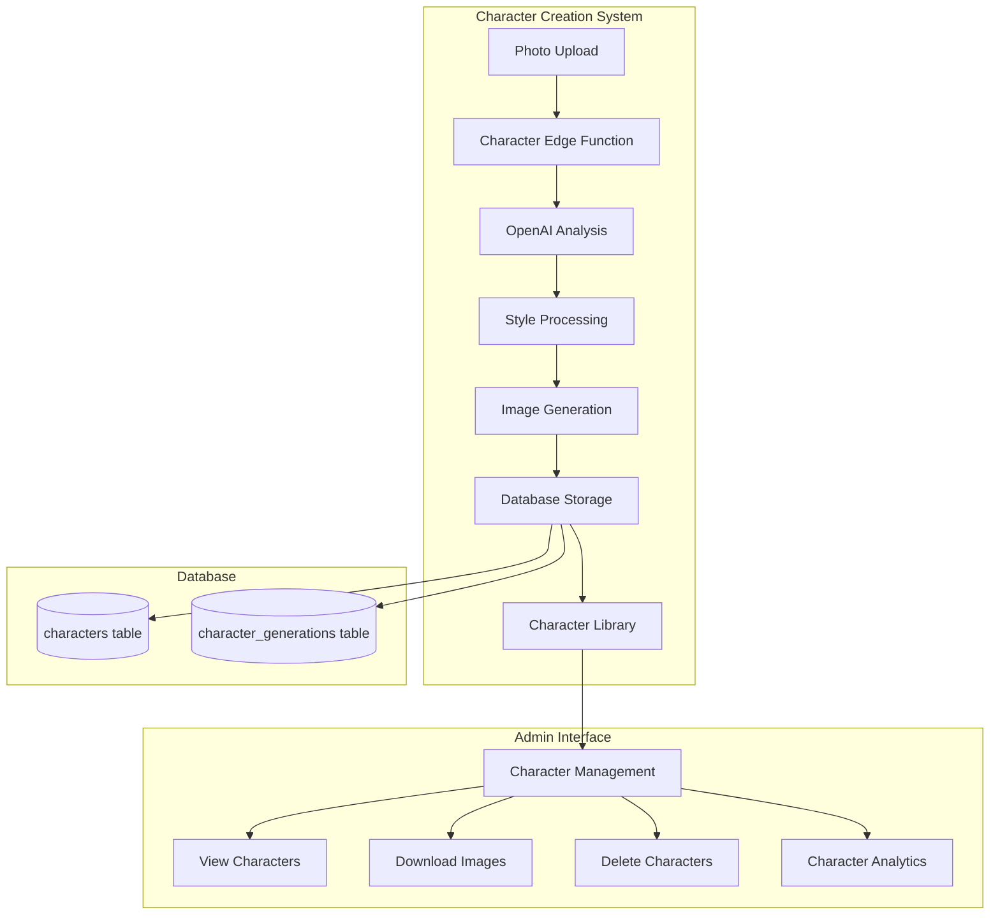

# Character Creation System - Complete Guide

**Version:** 1.0  
**Last Updated:** 2025-08-24  
**Audience:** Developers, Engineers, Technical Team

---

## Table of Contents

1. [System Overview](#system-overview)
2. [Architecture](#architecture)
3. [Character Edge Function](#character-edge-function)
4. [Database Schema](#database-schema)
5. [Frontend Components](#frontend-components)
6. [Admin Management](#admin-management)
7. [API Reference](#api-reference)
8. [Character Styles](#character-styles)
9. [Seed System](#seed-system)
10. [Integration Examples](#integration-examples)

---

## System Overview

The Character Creation System is a standalone module that transforms uploaded person photos into various artistic character styles. It's completely isolated from the main image generation pipeline and provides dedicated character management capabilities.

### Key Features

- **Multiple Character Styles**: Pixar 3D, Vector Art, Realistic Digital Art
- **Seed-Based Consistency**: Reproducible character generation using unique seeds
- **Character Library**: Persistent storage and management of created characters
- **Admin Dashboard**: Comprehensive character management interface
- **Style Flexibility**: Easy switching between different artistic interpretations

### Character Types Supported

| Style | Description | Use Cases |
|-------|-------------|-----------|
| **Pixar** | 3D animated style with large expressive eyes, colorful, child-friendly | Children's content, family-friendly materials |
| **Vector** | Clean geometric lines, flat colors, modern illustration | Professional presentations, clean branding |
| **Realistic** | Photorealistic digital art with natural lighting | Professional portraits, realistic representations |

---

## Architecture



### Core Components

1. **CharacterCreator Component**: Main user interface for character creation
2. **Character Edge Function**: Backend processing and AI integration
3. **CharacterManagement Component**: Admin interface for character oversight
4. **Database Schema**: Persistent storage for characters and generations

---

## Character Edge Function

**Endpoint:** `supabase/functions/character/index.ts`

### Function Overview

The character edge function handles the complete character creation pipeline:

1. **Image Analysis**: Uses GPT-4.1 to analyze physical characteristics
2. **Style Processing**: Applies style-specific prompts based on character type
3. **Image Generation**: Creates character using gpt-image-1 model
4. **Database Storage**: Saves character data and generation history
5. **Seed Management**: Handles seed generation and storage for consistency

### Request Parameters

```typescript
interface CharacterRequest {
  image: string;           // Base64 encoded image data
  prompt: string;          // User's character description
  characterType?: 'pixar' | 'vector' | 'realistic';  // Default: 'pixar'
  seed?: string;           // Optional seed for reproducibility
}
```

### Response Format

```typescript
interface CharacterResponse {
  success: boolean;
  imageData: string;       // Base64 encoded generated image
  characterAnalysis: string; // AI analysis of original photo
  stylePrompt: string;     // Generated style-specific prompt
  characterId: string;     // Database ID of created character
  seed: string;           // Unique seed for this character
  characterType: string;   // Confirmed character type used
}
```

### Style-Specific Prompt Templates

#### Pixar Style
```
Pixar 3D animated character: {characterDescription}, {userPrompt}. 
Large expressive eyes (1.5x normal size), soft rounded facial features, 
warm studio lighting, high-quality 3D render in Disney Pixar movie animation style, 
vibrant colors, child-friendly appearance, professional animation quality, 
detailed textures, glossy finish typical of Pixar films.
```

#### Vector Style
```
Vector illustration character: {characterDescription}, {userPrompt}. 
Clean geometric lines, bold solid colors, minimalist design, 
flat illustration style, modern vector art aesthetic, smooth gradients, 
digital art style, professional vector illustration, scalable design.
```

#### Realistic Style
```
Realistic digital art character: {characterDescription}, {userPrompt}. 
Photorealistic rendering, natural lighting, detailed textures, 
high-resolution digital painting, professional portrait quality, 
realistic proportions and features.
```

---

## Database Schema

### `characters` Table

Enhanced with character creation system support:

| Column | Type | Description |
|--------|------|-------------|
| `id` | UUID | Primary key |
| `user_id` | UUID | User identifier |
| `character_name` | TEXT | Display name for character |
| `character_description` | TEXT | AI-generated analysis |
| `original_image_url` | TEXT | Original photo (base64) |
| `sample_image_url` | TEXT | Generated character image |
| `image_hash` | TEXT | Hash for original image |
| `seed` | TEXT | **NEW: Unique generation seed** |
| `character_type` | TEXT | **NEW: pixar/vector/realistic** |
| `style_prompt` | TEXT | **NEW: Generated style prompt** |
| `original_photo_hash` | TEXT | **NEW: Hash for duplicate detection** |
| `style` | TEXT | Legacy style field |
| `created_at` | TIMESTAMP | Creation time |
| `updated_at` | TIMESTAMP | Last update time |

### `character_generations` Table

Enhanced to track all character generation attempts:

| Column | Type | Description |
|--------|------|-------------|
| `id` | UUID | Primary key |
| `user_id` | UUID | User identifier |
| `character_id` | UUID | Reference to parent character |
| `user_prompt` | TEXT | Original user prompt |
| `enhanced_prompt` | TEXT | AI-enhanced prompt |
| `generated_image_url` | TEXT | Generated image URL |
| `style` | TEXT | Character style used |
| `seed` | TEXT | **NEW: Generation seed** |
| `character_type` | TEXT | **NEW: Character type** |
| `created_at` | TIMESTAMP | Generation time |

### Database Indexes

```sql
-- Performance indexes for character lookups
CREATE INDEX idx_characters_user_type ON characters(user_id, character_type);
CREATE INDEX idx_characters_hash ON characters(original_photo_hash);
CREATE INDEX idx_character_generations_character_id ON character_generations(character_id);
```

---

## Frontend Components

### CharacterCreator Component

**Location:** `src/components/CharacterCreator.tsx`

Main interface for character creation with:

- **Photo Upload**: Drag & drop, paste, or file selection
- **Style Selection**: Dropdown for Pixar/Vector/Realistic
- **Prompt Input**: Text field for character description
- **Seed Management**: Optional seed input with generation button
- **Quick Prompts**: Predefined prompts for common scenarios
- **Results Display**: Generated character with download option

#### Key Features

```typescript
// Style selection with descriptions
const characterTypeOptions = [
  {
    value: 'pixar',
    label: 'Pixar Style',
    description: '3D animated, large eyes, colorful'
  },
  {
    value: 'vector',
    label: 'Vector Art', 
    description: 'Clean geometric, flat colors'
  },
  {
    value: 'realistic',
    label: 'Realistic',
    description: 'Photorealistic, natural lighting'
  }
];
```

#### Usage Example

```tsx
import { CharacterCreator } from '@/components/CharacterCreator';

function CharacterPage() {
  return <CharacterCreator />;
}
```

### CharacterManagement Component

**Location:** `src/components/admin/CharacterManagement.tsx`

Admin interface for character oversight:

- **Character Grid/List View**: Toggleable display modes
- **Search & Filtering**: By name, description, or character type
- **Character Details**: Modal with full character information
- **Generation History**: View all generations for each character
- **Bulk Operations**: Download and delete functionality
- **Analytics**: Character usage and creation statistics

---

## Admin Management

### Settings Integration

Character management is integrated into the admin settings modal:

```tsx
// In SettingsModal.tsx
{activeSection === 'characters' && <CharacterManagement />}
```

### Access Control

- **User Access**: Users can only see their own characters
- **Admin Access**: Full access to all characters across users
- **RLS Policies**: Row-level security enforces access control

### Character Operations

```typescript
// Load all characters
const loadCharacters = async () => {
  const { data } = await supabase
    .from('characters')
    .select('*')
    .order('created_at', { ascending: false });
};

// Delete character
const deleteCharacter = async (characterId: string) => {
  await supabase
    .from('characters')
    .delete()
    .eq('id', characterId);
};

// Load character generations
const loadCharacterGenerations = async (characterId: string) => {
  const { data } = await supabase
    .from('character_generations')
    .select('*')
    .eq('character_id', characterId)
    .order('created_at', { ascending: false });
};
```

---

## API Reference

### Character Creation

**Endpoint:** `POST /functions/v1/character`

**Headers:**
```
Authorization: Bearer {supabase_auth_token}
Content-Type: application/json
```

**Request Body:**
```json
{
  "image": "base64_encoded_image_data",
  "prompt": "as a superhero with a flowing cape",
  "characterType": "pixar",
  "seed": "optional_seed_string"
}
```

**Success Response:**
```json
{
  "success": true,
  "imageData": "data:image/png;base64,{generated_image}",
  "characterAnalysis": "Young person with oval face...",
  "stylePrompt": "Pixar 3D animated character...",
  "characterId": "uuid-string",
  "seed": "char_1234567890_abc123",
  "characterType": "pixar"
}
```

**Error Response:**
```json
{
  "error": "Missing required parameters: image and prompt"
}
```

### Database Queries

#### Get User Characters
```sql
SELECT * FROM characters 
WHERE user_id = $1 
ORDER BY created_at DESC;
```

#### Get Character Generations
```sql
SELECT * FROM character_generations 
WHERE character_id = $1 
ORDER BY created_at DESC;
```

#### Find Character by Seed
```sql
SELECT * FROM characters 
WHERE seed = $1 AND user_id = $2;
```

---

## Character Styles

### Style Comparison

| Aspect | Pixar | Vector | Realistic |
|--------|-------|--------|-----------|
| **Eyes** | Large, expressive (1.5x) | Simplified, geometric | Natural proportions |
| **Colors** | Vibrant, saturated | Bold, flat colors | Natural, realistic |
| **Lighting** | Warm studio lighting | Minimal shadows | Natural lighting |
| **Textures** | Glossy, detailed | Flat, clean | Photorealistic |
| **Proportions** | Stylized, rounded | Geometric, clean | Anatomically correct |

### Prompt Enhancement

The system automatically enhances minimal prompts:

```typescript
const enhancePrompt = (userPrompt: string, type: CharacterType): string => {
  const defaults = {
    pixar: 'as a cheerful character with large expressive eyes in a magical, colorful setting',
    vector: 'as a clean, modern character with bold colors and geometric shapes', 
    realistic: 'as a detailed, lifelike character with natural lighting and realistic proportions'
  };
  
  if (userPrompt.length < 10 || userPrompt === type) {
    return defaults[type];
  }
  
  return userPrompt.trim();
};
```

---

## Seed System

### Seed Generation

Seeds are automatically generated using timestamp and random components:

```typescript
const characterSeed = seed || `char_${Date.now()}_${Math.random().toString(36).substr(2, 9)}`;
```

### Seed Benefits

1. **Reproducibility**: Same seed + same base characteristics = similar results
2. **Character Consistency**: Maintain character identity across generations
3. **Version Control**: Track different versions of the same character
4. **User Control**: Users can specify seeds for specific results

### Seed Usage Examples

```typescript
// Generate character with specific seed
const createCharacter = async () => {
  const response = await supabase.functions.invoke('character', {
    body: {
      image: imageData,
      prompt: 'as a wizard in a magical library',
      characterType: 'pixar',
      seed: 'char_1234567890_wizard01' // Consistent seed
    }
  });
};

// Regenerate same character with different prompt
const regenerateCharacter = async (existingSeed: string) => {
  const response = await supabase.functions.invoke('character', {
    body: {
      image: imageData,
      prompt: 'as an astronaut exploring space', // Different scenario
      characterType: 'pixar',
      seed: existingSeed // Same seed for consistency
    }
  });
};
```

---

## Integration Examples

### Basic Character Creation

```tsx
import { useState } from 'react';
import { CharacterCreator } from '@/components/CharacterCreator';

function MyApp() {
  return (
    <div>
      <h1>Create Your Character</h1>
      <CharacterCreator />
    </div>
  );
}
```

### Custom Character Integration

```tsx
import { supabase } from '@/integrations/supabase/client';

const createCustomCharacter = async (imageFile: File, style: string) => {
  // Convert file to base64
  const reader = new FileReader();
  const base64 = await new Promise((resolve) => {
    reader.onload = () => resolve(reader.result?.toString().split(',')[1]);
    reader.readAsDataURL(imageFile);
  });

  // Create character
  const { data, error } = await supabase.functions.invoke('character', {
    body: {
      image: base64,
      prompt: 'as a professional business person',
      characterType: style,
    }
  });

  if (data?.success) {
    console.log('Character created:', data.characterId);
    return data.imageData;
  }
  
  throw new Error(data?.error || 'Failed to create character');
};
```

### Character Library Integration

```tsx
import { useEffect, useState } from 'react';
import { supabase } from '@/integrations/supabase/client';

function CharacterLibrary() {
  const [characters, setCharacters] = useState([]);

  useEffect(() => {
    const loadCharacters = async () => {
      const { data } = await supabase
        .from('characters')
        .select('*')
        .eq('user_id', user.id)
        .order('created_at', { ascending: false });
      
      setCharacters(data || []);
    };

    loadCharacters();
  }, []);

  return (
    <div className="character-grid">
      {characters.map(character => (
        <div key={character.id} className="character-card">
          
          <h3>{character.character_name}</h3>
          <p>{character.character_type}</p>
          <code>{character.seed}</code>
        </div>
      ))}
    </div>
  );
}
```

---

## Migration from Pixar Function

### Breaking Changes

1. **Function Name**: `pixar` → `character`
2. **New Parameter**: `characterType` required (defaults to 'pixar')
3. **Enhanced Response**: Additional metadata fields
4. **Database Schema**: New columns in characters table

### Migration Path

```typescript
// OLD: Using pixar function
const { data } = await supabase.functions.invoke('pixar', {
  body: { image, prompt }
});

// NEW: Using character function
const { data } = await supabase.functions.invoke('character', {
  body: { 
    image, 
    prompt, 
    characterType: 'pixar' // Maintain same behavior
  }
});
```

### Backward Compatibility

The character function maintains full backward compatibility with existing pixar function calls by defaulting `characterType` to 'pixar' when not specified.

---

**Last Updated:** 2025-08-24  
**Version:** 1.0  
**Maintainer:** Engineering Team