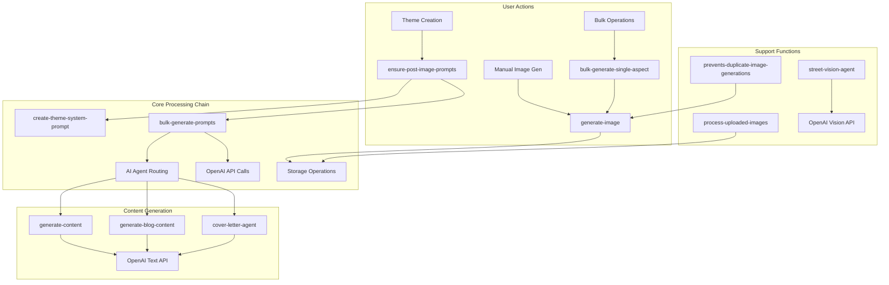

# Edge Functions Reference Guide

**Version:** 1.0  
**Last Updated:** 2025-09-07  
**Audience:** Developers, DevOps, Backend Engineers

---

## 🎯 Overview

Comprehensive reference for all edge functions in the Stories & Theme Generation System, including dependencies, data flows, security requirements, and integration patterns.

**Quick Navigation:**
- [🗂️ Function Categories](#️-function-categories)
- [🔄 Function Dependencies](#-function-dependencies)
- [📊 Core Functions Detail](#-core-functions-detail)
- [🔒 Security & Authentication](#-security--authentication)
- [⚡ Performance & Monitoring](#-performance--monitoring)
- [🛠️ Development & Deployment](#️-development--deployment)

---

## 🗂️ Function Categories

### Theme & Content Processing Functions

| Function | Purpose | Type | Dependencies |
|----------|---------|------|-------------|
| `ensure-post-image-prompts` | Background processing orchestrator | Orchestration | `bulk-generate-prompts` |
| `bulk-generate-prompts` | Batch prompt generation | Processing | OpenAI API |
| `create-theme-system-prompt` | System prompt routing | AI Agent | OpenAI API |

### Image Generation Functions

| Function | Purpose | Type | Dependencies |
|----------|---------|------|-------------|
| `generate-image` | Single image generation | Processing | OpenAI Images API |
| `bulk-generate-single-aspect` | Bulk single aspect generation | Processing | `generate-image` |
| `streaming-image-pipeline` | Real-time image generation | Streaming | OpenAI API |
| `prevents-duplicate-image-generations` | Duplicate prevention | Control | Database |

### Content & Agent Functions

| Function | Purpose | Type | Dependencies |
|----------|---------|------|-------------|
| `generate-content` | Content generation | AI Agent | OpenAI API |
| `generate-blog-content` | Blog content creation | AI Agent | OpenAI API |
| `cover-letter-agent` | Cover letter generation | AI Agent | OpenAI API |
| `generate-voiceover-script` | Script generation | AI Agent | OpenAI API |

### Utility & Processing Functions

| Function | Purpose | Type | Dependencies |
|----------|---------|------|-------------|
| `process-theme-json` | Theme data processing | Processing | None |
| `process-uploaded-images` | Image processing | Processing | Storage API |
| `street-vision-agent` | Image analysis | AI Agent | OpenAI Vision API |

---

## 🔄 Function Dependencies

### Dependency Flow Diagram



### Critical Path Functions

#### Theme Processing Critical Path
```
Theme Creation → ensure-post-image-prompts → bulk-generate-prompts → generate-image
```

**Failure Impact:** Complete theme processing failure
**Recovery:** Manual retry mechanisms, status reset

#### Image Generation Critical Path
```
Image Request → prevents-duplicate-image-generations → generate-image → Storage Upload
```

**Failure Impact:** Missing images for posts
**Recovery:** Individual retry, bulk regeneration

---

## 📊 Core Functions Detail

### `ensure-post-image-prompts`

**Purpose:** Background orchestration of theme processing pipeline

#### Function Signature
```typescript
interface EnsurePostImagePromptsRequest {
  theme_id: string;
  force_reprocess?: boolean;
  debug?: boolean;
}

interface EnsurePostImagePromptsResponse {
  success: boolean;
  processed_posts: number;
  skipped_posts: number;
  errors: string[];
  processing_time_ms: number;
}
```

#### Implementation Flow
```typescript
export default async function ensurePostImagePrompts(req: Request) {
  const { theme_id, force_reprocess = false } = await req.json();
  
  // 1. Query theme and posts
  const theme = await getThemeWithCategory(theme_id);
  const posts = await getPostsNeedingProcessing(theme_id, force_reprocess);
  
  // 2. Assign system prompts if needed
  await ensureSystemPrompts(theme_id, theme.category);
  
  // 3. Process image prompts in bulk
  if (posts.length > 0) {
    await supabase.functions.invoke('bulk-generate-prompts', {
      body: {
        posts: posts,
        theme_id: theme_id,
        category: theme.category,
        mode: 'missing_only'
      }
    });
  }
  
  return new Response(JSON.stringify({
    success: true,
    processed_posts: posts.length
  }));
}
```

#### Database Queries
```sql
-- Get posts needing processing
SELECT smp.id, smp.title, smp.description, smp.day, smp.individual_prompt_status
FROM social_media_posts smp
JOIN themes t ON t.id = smp.theme_id
WHERE smp.theme_id = $1 
  AND smp.user_id = $2
  AND (
    smp.individual_prompt_status = 'pending' 
    OR smp.generated_image_prompt IS NULL
    OR $3 = true  -- force_reprocess
  )
ORDER BY smp.day ASC NULLS FIRST;
```

#### Error Handling
- **Theme not found**: Return 404 with clear message
- **No posts to process**: Return success with 0 count
- **Bulk processing failure**: Log error, return partial success
- **Database connection issues**: Retry with exponential backoff

---

### `bulk-generate-prompts`

**Purpose:** Efficient batch processing of image prompt generation

#### Function Signature
```typescript
interface BulkGeneratePromptsRequest {
  posts: Array<{
    id: string;
    title: string;
    description: string;
    day?: number;
  }>;
  theme_id: string;
  category: string;
  mode: 'all' | 'missing_only';
}

interface BulkGeneratePromptsResponse {
  success: boolean;
  results: Array<{
    post_id: string;
    success: boolean;
    prompt?: string;
    error?: string;
  }>;
  total_processed: number;
  successful: number;
  failed: number;
}
```

#### Batch Processing Logic
```typescript
export default async function bulkGeneratePrompts(req: Request) {
  const { posts, theme_id, category, mode } = await req.json();
  
  console.log(`🚀 Processing batch of ${posts.length} prompts for theme ${theme_id}`);
  
  const batchSize = 26; // Optimal batch size for OpenAI rate limits
  const batches = chunk(posts, batchSize);
  const allResults = [];
  
  for (const batch of batches) {
    const batchResults = await Promise.allSettled(
      batch.map(post => generateSinglePrompt(post, category))
    );
    
    const results = batchResults.map((result, index) => ({
      post_id: batch[index].id,
      success: result.status === 'fulfilled',
      prompt: result.status === 'fulfilled' ? result.value.prompt : undefined,
      error: result.status === 'rejected' ? result.reason.message : undefined
    }));
    
    // Update database with batch results
    await updatePostsWithPrompts(results.filter(r => r.success));
    allResults.push(...results);
  }
  
  const successful = allResults.filter(r => r.success).length;
  const failed = allResults.filter(r => !r.success).length;
  
  console.log(`✅ Batch complete: ${successful} success, ${failed} failed`);
  
  return new Response(JSON.stringify({
    success: true,
    results: allResults,
    total_processed: posts.length,
    successful,
    failed
  }));
}
```

#### Performance Optimizations
- **Batch Processing**: Process 26 posts simultaneously
- **Concurrency Control**: Limit concurrent OpenAI API calls
- **Error Resilience**: Continue processing on individual failures
- **Database Batching**: Update multiple posts in single query

---

### `generate-image`

**Purpose:** Single image generation with OpenAI GPT-Image-1

#### Function Signature
```typescript
interface GenerateImageRequest {
  prompt: string;
  aspectRatio: '1:1' | '16:9' | '4:3' | '9:16' | '3:4';
  size?: string;
  quality?: 'low' | 'medium' | 'high';
  seed?: string;
  outputFormat?: 'png' | 'jpeg' | 'webp';
  category?: string;
  postId?: string;
}

interface GenerateImageResponse {
  success: boolean;
  image: string; // Base64 encoded
  imageUrl?: string; // If uploaded to storage
  aspectRatio: string;
  size: string;
  seed?: string;
  usage: {
    estimatedCost: number;
    actualCost?: number;
  };
  processingTimeMs: number;
  correlationId: string;
}
```

#### OpenAI Integration
```typescript
async function generateImageWithOpenAI(prompt: string, config: ImageConfig) {
  const enhancedPrompt = enhancePromptForAspectRatio(prompt, config.aspectRatio);
  
  const response = await openai.images.generate({
    model: 'gpt-image-1',
    prompt: enhancedPrompt,
    size: mapAspectRatioToSize(config.aspectRatio),
    quality: config.quality || 'high',
    output_format: config.outputFormat || 'jpeg',
    response_format: 'b64_json' // Always base64 for consistency
  });
  
  return {
    imageData: response.data[0].b64_json,
    usage: calculateImageGenerationCost(config)
  };
}
```

#### Storage Integration
```typescript
async function uploadImageToStorage(
  imageData: string, 
  postId: string, 
  aspectRatio: string
): Promise<string> {
  const fileName = `${postId}_${aspectRatio.replace(':', 'x')}.jpg`;
  const filePath = `social-media-images/${fileName}`;
  
  // Convert base64 to blob
  const imageBlob = base64ToBlob(imageData, 'image/jpeg');
  
  // Upload to Supabase Storage
  const { data, error } = await supabase.storage
    .from('social-media-images')
    .upload(filePath, imageBlob, {
      contentType: 'image/jpeg',
      upsert: true
    });
    
  if (error) throw error;
  
  // Return public URL
  const { data: { publicUrl } } = supabase.storage
    .from('social-media-images')
    .getPublicUrl(filePath);
    
  return publicUrl;
}
```

---

### `create-theme-system-prompt`

**Purpose:** AI agent routing and system prompt generation

#### Agent Routing Logic
```typescript
function routeToAgent(category: string): string {
  const agentMap = {
    'healthcare': 'healthcare-content-agent',
    'design': 'design-content-agent',
    'marketing': 'marketing-content-agent',
    'education': 'education-content-agent',
    'business': 'business-content-agent',
    'default': 'general-content-agent'
  };
  
  return agentMap[category] || agentMap.default;
}

async function generateSystemPrompt(category: string, context: any) {
  const agent = routeToAgent(category);
  const agentConfig = await getAgentConfiguration(agent);
  
  const systemPrompt = await openai.chat.completions.create({
    model: 'gpt-4o-mini',
    messages: [
      {
        role: 'system',
        content: agentConfig.systemPrompt
      },
      {
        role: 'user',
        content: `Generate a system prompt for ${category} content creation. Context: ${JSON.stringify(context)}`
      }
    ],
    max_tokens: 500,
    temperature: 0.7
  });
  
  return systemPrompt.choices[0].message.content;
}
```

---

## 🔒 Security & Authentication

### Authentication Requirements

#### JWT Token Validation
```typescript
// Standard JWT validation for all functions
async function validateJWT(req: Request): Promise<User | null> {
  const authHeader = req.headers.get('Authorization');
  if (!authHeader?.startsWith('Bearer ')) {
    throw new Error('Missing or invalid authorization header');
  }
  
  const token = authHeader.substring(7);
  const { data: { user }, error } = await supabase.auth.getUser(token);
  
  if (error || !user) {
    throw new Error('Invalid or expired token');
  }
  
  return user;
}
```

#### RLS Policy Enforcement
```sql
-- Example RLS policies for themes table
CREATE POLICY "Users can view their own themes" ON themes
  FOR SELECT USING (auth.uid() = user_id);

CREATE POLICY "Users can create their own themes" ON themes  
  FOR INSERT WITH CHECK (auth.uid() = user_id);

CREATE POLICY "Users can update their own themes" ON themes
  FOR UPDATE USING (auth.uid() = user_id);
```

### Security Headers

#### CORS Configuration
```typescript
const corsHeaders = {
  'Access-Control-Allow-Origin': '*',
  'Access-Control-Allow-Headers': 'authorization, x-client-info, apikey, content-type',
  'Access-Control-Allow-Methods': 'POST, OPTIONS'
};

// Handle preflight requests
if (req.method === 'OPTIONS') {
  return new Response(null, { headers: corsHeaders });
}
```

#### Content Security
```typescript
// Input validation and sanitization
function validateAndSanitizeInput(input: any): any {
  // Remove potentially dangerous content
  const sanitized = DOMPurify.sanitize(input);
  
  // Validate against schema
  const validation = inputSchema.safeParse(sanitized);
  if (!validation.success) {
    throw new Error('Invalid input format');
  }
  
  return validation.data;
}
```

### Rate Limiting

#### Function-Level Rate Limiting
```typescript
const rateLimiter = new Map<string, { count: number; resetTime: number }>();

function checkRateLimit(userId: string, maxRequests: number = 100): boolean {
  const now = Date.now();
  const windowMs = 60 * 1000; // 1 minute window
  
  const userLimit = rateLimiter.get(userId);
  
  if (!userLimit || now > userLimit.resetTime) {
    rateLimiter.set(userId, { count: 1, resetTime: now + windowMs });
    return true;
  }
  
  if (userLimit.count >= maxRequests) {
    return false;
  }
  
  userLimit.count++;
  return true;
}
```

---

## ⚡ Performance & Monitoring

### Performance Optimization Patterns

#### Batch Processing
```typescript
// Optimal batch sizes for different operations
const BATCH_SIZES = {
  PROMPT_GENERATION: 26,    // OpenAI rate limit optimized
  IMAGE_GENERATION: 5,      // Balance speed vs. cost
  DATABASE_UPDATE: 50,      // Database optimization
  FILE_UPLOAD: 10          // Storage optimization
};

async function processBatch<T>(
  items: T[], 
  processor: (item: T) => Promise<any>,
  batchSize: number
): Promise<any[]> {
  const batches = chunk(items, batchSize);
  const results = [];
  
  for (const batch of batches) {
    const batchResults = await Promise.allSettled(
      batch.map(processor)
    );
    results.push(...batchResults);
  }
  
  return results;
}
```

#### Caching Strategies
```typescript
// In-memory cache for system prompts
const systemPromptCache = new Map<string, { prompt: string; expires: number }>();

async function getCachedSystemPrompt(category: string): Promise<string | null> {
  const cached = systemPromptCache.get(category);
  const now = Date.now();
  
  if (cached && now < cached.expires) {
    return cached.prompt;
  }
  
  // Clean expired entries
  if (cached && now >= cached.expires) {
    systemPromptCache.delete(category);
  }
  
  return null;
}

function setCachedSystemPrompt(category: string, prompt: string): void {
  const expires = Date.now() + (30 * 60 * 1000); // 30 minutes
  systemPromptCache.set(category, { prompt, expires });
}
```

### Monitoring & Logging

#### Structured Logging
```typescript
interface LogEvent {
  timestamp: string;
  level: 'DEBUG' | 'INFO' | 'WARN' | 'ERROR';
  functionName: string;
  operation: string;
  correlationId: string;
  data?: any;
  error?: any;
}

function log(level: LogEvent['level'], message: string, data?: any): void {
  const logEvent: LogEvent = {
    timestamp: new Date().toISOString(),
    level,
    functionName: 'bulk-generate-prompts',
    operation: 'batch_processing',
    correlationId: generateCorrelationId(),
    data
  };
  
  console.log(JSON.stringify(logEvent));
}
```

#### Performance Metrics
```typescript
class PerformanceTracker {
  private timers = new Map<string, number>();
  
  startTimer(operation: string): void {
    this.timers.set(operation, Date.now());
  }
  
  endTimer(operation: string): number {
    const start = this.timers.get(operation);
    if (!start) return 0;
    
    const duration = Date.now() - start;
    this.timers.delete(operation);
    
    log('INFO', `Performance: ${operation}`, { duration });
    return duration;
  }
}
```

### Error Handling Patterns

#### Comprehensive Error Handling
```typescript
async function executeWithErrorHandling<T>(
  operation: () => Promise<T>,
  context: string
): Promise<T> {
  try {
    return await operation();
  } catch (error) {
    log('ERROR', `Operation failed: ${context}`, {
      error: error.message,
      stack: error.stack,
      context
    });
    
    // Determine if error is retryable
    if (isRetryableError(error)) {
      throw new RetryableError(error.message);
    }
    
    throw error;
  }
}

function isRetryableError(error: any): boolean {
  // Network errors, rate limits, temporary API issues
  return error.code === 'NETWORK_ERROR' ||
         error.status === 429 ||
         error.status >= 500;
}
```

---

## 🛠️ Development & Deployment

### Local Development Setup

#### Environment Configuration
```bash
# .env.local
SUPABASE_URL=your-project-url
SUPABASE_ANON_KEY=your-anon-key
SUPABASE_SERVICE_ROLE_KEY=your-service-role-key
OPENAI_API_KEY=your-openai-key
```

#### Function Testing
```typescript
// Test individual functions locally
async function testBulkGeneratePrompts() {
  const testPayload = {
    posts: [
      { id: 'test-1', title: 'Test Post', description: 'Test description' }
    ],
    theme_id: 'test-theme',
    category: 'healthcare',
    mode: 'missing_only'
  };
  
  const response = await supabase.functions.invoke('bulk-generate-prompts', {
    body: testPayload
  });
  
  console.log('Test result:', response);
}
```

### Deployment Configuration

#### Function Configuration (supabase/config.toml)
```toml
[functions.ensure-post-image-prompts]
verify_jwt = true

[functions.bulk-generate-prompts]  
verify_jwt = true

[functions.generate-image]
verify_jwt = true

[functions.create-theme-system-prompt]
verify_jwt = true
```

#### CI/CD Pipeline Integration
```yaml
# .github/workflows/deploy-functions.yml
name: Deploy Edge Functions
on:
  push:
    branches: [main]

jobs:
  deploy:
    runs-on: ubuntu-latest
    steps:
      - uses: actions/checkout@v3
      - uses: supabase/setup-cli@v1
      - run: supabase functions deploy --project-ref ${{ secrets.PROJECT_REF }}
```

### Testing Strategies

#### Integration Testing
```typescript
describe('Theme Processing Integration', () => {
  test('complete theme processing pipeline', async () => {
    // 1. Create test theme
    const theme = await createTestTheme();
    
    // 2. Trigger processing
    const result = await supabase.functions.invoke('ensure-post-image-prompts', {
      body: { theme_id: theme.id }
    });
    
    // 3. Verify results
    expect(result.data.success).toBe(true);
    
    // 4. Check posts were processed
    const posts = await getThemePosts(theme.id);
    expect(posts.every(p => p.individual_prompt_status === 'completed')).toBe(true);
  });
});
```

#### Load Testing
```typescript
// Test bulk processing under load
async function loadTestBulkProcessing() {
  const concurrentRequests = 10;
  const postsPerRequest = 26;
  
  const requests = Array(concurrentRequests).fill(null).map(() =>
    supabase.functions.invoke('bulk-generate-prompts', {
      body: generateTestPayload(postsPerRequest)
    })
  );
  
  const results = await Promise.allSettled(requests);
  const successful = results.filter(r => r.status === 'fulfilled').length;
  
  console.log(`Load test: ${successful}/${concurrentRequests} successful`);
}
```

---

This comprehensive reference provides detailed documentation for all edge functions in the Stories & Theme Generation System, with focus on the bulk processing architecture, security implementations, and production deployment patterns.