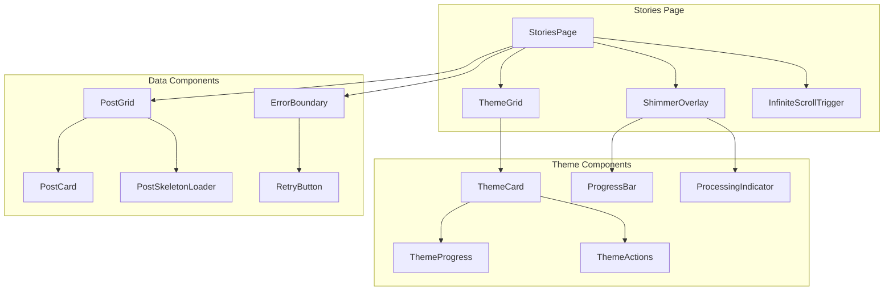

# Frontend Integration Guide

**Version:** 1.0  
**Last Updated:** 2025-09-07  
**Audience:** Frontend Developers, React Engineers

---

## 🎯 Overview

This guide covers frontend integration patterns for the Stories & Theme Generation System, focusing on React hooks, component architecture, real-time updates, and user experience patterns.

**Quick Navigation:**
- [🎣 Core Hooks](#-core-hooks)
- [🧩 Component Architecture](#-component-architecture)
- [⚡ Real-time Integration](#-real-time-integration)
- [🎨 UI/UX Patterns](#-uiux-patterns)
- [📊 State Management](#-state-management)
- [🔧 Performance Optimization](#-performance-optimization)
- [🐛 Error Handling](#-error-handling)

---

## 🎣 Core Hooks

### `useOptimizedStoriesData`

**Purpose:** Efficient data loading and caching for the Stories page with pagination and selective loading.

#### Hook Signature
```typescript
interface UseOptimizedStoriesDataProps {
  pageSize?: number;
  preloadImages?: boolean;
}

interface UseOptimizedStoriesDataReturn {
  themes: Theme[];
  posts: SocialMediaPost[];
  groupedPosts: Record<string, SocialMediaPost[]>;
  loading: boolean;
  error: string | null;
  hasMorePosts: boolean;
  loadMorePosts: () => void;
  loadImageData: (postId: string) => Promise<any>;
  refreshData: () => Promise<void>;
}
```

#### Usage Example
```typescript
function StoriesPage() {
  const {
    themes,
    posts,
    groupedPosts,
    loading,
    error,
    hasMorePosts,
    loadMorePosts,
    refreshData
  } = useOptimizedStoriesData({
    pageSize: 50,
    preloadImages: false // Load images on-demand for performance
  });

  if (loading) return <StoriesSkeletonLoader />;
  if (error) return <ErrorBoundary error={error} />;

  return (
    <div className="stories-container">
      <ThemeGrid themes={themes} posts={groupedPosts} />
      {hasMorePosts && (
        <InfiniteScrollTrigger onLoadMore={loadMorePosts} />
      )}
    </div>
  );
}
```

#### Key Features
- **Selective Loading**: Only loads essential fields initially
- **Pagination**: Efficient offset-based pagination with `loadMorePosts`
- **Image Loading**: On-demand image data loading with `loadImageData`
- **Grouped Data**: Automatically groups posts by theme for efficient rendering
- **Refresh**: Manual refresh capability for data synchronization

---

### `useThemeShimmer`

**Purpose:** Real-time progress tracking and shimmer effect management for theme processing.

#### Hook Signature
```typescript
interface UseThemeShimmerProps {
  pendingTheme: PendingTheme | null;
  setPendingTheme: (theme: PendingTheme | null) => void;
}

interface UseThemeShimmerReturn {
  shouldShowShimmer: boolean;
  completionProgress: {
    isComplete: boolean;
    percentage: number;
    completedCount: number;
    totalCount: number;
  };
  dismissShimmer: () => void;
  handleThemeClick: (themeId: string) => void;
}
```

#### Implementation Example
```typescript
function StoriesPageWithShimmer() {
  const [pendingTheme, setPendingTheme] = useState<PendingTheme | null>(null);
  
  const {
    shouldShowShimmer,
    completionProgress,
    dismissShimmer,
    handleThemeClick
  } = useThemeShimmer({
    pendingTheme,
    setPendingTheme
  });

  return (
    <div>
      {/* Shimmer overlay during processing */}
      {shouldShowShimmer && (
        <ShimmerOverlay
          progress={completionProgress}
          onDismiss={dismissShimmer}
          themeName={pendingTheme?.theme_name}
        />
      )}
      
      {/* Theme grid with click handlers */}
      <ThemeGrid
        themes={themes}
        onThemeClick={handleThemeClick}
      />
    </div>
  );
}
```

#### Real-time Subscription Logic
```typescript
// Inside useThemeShimmer hook
useEffect(() => {
  if (!pendingTheme?.theme_id) return;

  const subscription = supabase
    .channel('social_media_posts')
    .on('postgres_changes', {
      event: 'UPDATE',
      schema: 'public',
      table: 'social_media_posts',
      filter: `theme_id=eq.${pendingTheme.theme_id}`
    }, (payload) => {
      setThemePosts(prev => prev.map(post => 
        post.id === payload.new.id 
          ? { ...post, ...payload.new } 
          : post
      ));
    })
    .subscribe();

  return () => subscription.unsubscribe();
}, [pendingTheme?.theme_id]);
```

---

### `useOptimizedStories`

**Purpose:** Theme-specific data management with tab navigation and caching.

#### Hook Signature
```typescript
interface UseOptimizedStoriesReturn {
  availableThemes: ThemeWithPosts[];
  activeTheme: ThemeWithPosts | null;
  loading: boolean;
  error: string | null;
  changeTab: (themeId: string) => void;
  invalidateCache: () => void;
}
```

#### Usage Pattern
```typescript
function ThemeDetailPage() {
  const { themeId } = useParams();
  const {
    availableThemes,
    activeTheme,
    loading,
    changeTab,
    invalidateCache
  } = useOptimizedStories(user);

  // Set active theme from URL
  useEffect(() => {
    if (themeId && availableThemes.length > 0) {
      changeTab(themeId);
    }
  }, [themeId, availableThemes, changeTab]);

  return (
    <div>
      <TabNavigation
        themes={availableThemes}
        activeThemeId={activeTheme?.id}
        onTabChange={changeTab}
      />
      
      {activeTheme && (
        <ThemeContent
          theme={activeTheme}
          onRefresh={invalidateCache}
        />
      )}
    </div>
  );
}
```

---

## 🧩 Component Architecture

### Theme Components Hierarchy



### Core Component Implementations

#### ThemeCard Component
```typescript
interface ThemeCardProps {
  theme: ThemeWithPosts;
  posts: SocialMediaPost[];
  onThemeClick: (themeId: string) => void;
  isProcessing?: boolean;
}

function ThemeCard({ theme, posts, onThemeClick, isProcessing }: ThemeCardProps) {
  const completedPosts = posts.filter(p => p.individual_prompt_status === 'completed').length;
  const totalPosts = posts.length;
  const progress = totalPosts > 0 ? (completedPosts / totalPosts) * 100 : 0;

  return (
    <div 
      className="theme-card cursor-pointer hover:shadow-lg transition-shadow"
      onClick={() => onThemeClick(theme.id)}
    >
      {/* Theme header */}
      <div className="theme-header">
        <h3 className="theme-title">{theme.theme_name}</h3>
        <span className="theme-category">{theme.category}</span>
      </div>
      
      {/* Processing indicator */}
      {isProcessing && (
        <div className="processing-indicator">
          <Spinner size="sm" />
          <span>Processing...</span>
        </div>
      )}
      
      {/* Progress bar */}
      <div className="progress-container">
        <div className="progress-bar">
          <div 
            className="progress-fill"
            style={{ width: `${progress}%` }}
          />
        </div>
        <span className="progress-text">
          {completedPosts}/{totalPosts} posts ready
        </span>
      </div>
      
      {/* First post preview */}
      {theme.first_post && (
        <PostPreview post={theme.first_post} />
      )}
    </div>
  );
}
```

#### ShimmerOverlay Component
```typescript
interface ShimmerOverlayProps {
  progress: {
    percentage: number;
    completedCount: number;
    totalCount: number;
    isComplete: boolean;
  };
  themeName?: string;
  onDismiss: () => void;
}

function ShimmerOverlay({ progress, themeName, onDismiss }: ShimmerOverlayProps) {
  return (
    <div className="fixed inset-0 bg-black/50 flex items-center justify-center z-50">
      <div className="bg-white rounded-lg p-6 max-w-md mx-4 min-w-[400px]">
        {/* Header */}
        <div className="text-center mb-6">
          <div className="animate-pulse mb-2">
            <Sparkles className="w-8 h-8 text-blue-500 mx-auto" />
          </div>
          <h3 className="text-lg font-semibold mb-2">
            Creating "{themeName}"
          </h3>
          <p className="text-gray-600 text-sm">
            Our AI is generating your content and images...
          </p>
        </div>

        {/* Progress visualization */}
        <div className="mb-6">
          <div className="flex justify-between text-sm text-gray-500 mb-2">
            <span>Progress</span>
            <span>{progress.percentage}%</span>
          </div>
          
          {/* Animated progress bar */}
          <div className="w-full bg-gray-200 rounded-full h-3 mb-3">
            <div 
              className="bg-gradient-to-r from-blue-500 to-purple-500 h-3 rounded-full transition-all duration-500 ease-out"
              style={{ width: `${progress.percentage}%` }}
            />
          </div>
          
          <div className="flex justify-between text-xs text-gray-400">
            <span>{progress.completedCount} posts ready</span>
            <span>{progress.totalCount} total posts</span>
          </div>
        </div>

        {/* Processing stages */}
        <ProcessingStages progress={progress} />
        
        {/* Dismiss button (only show after some progress) */}
        {progress.percentage > 25 && (
          <button
            onClick={onDismiss}
            className="w-full mt-4 px-4 py-2 text-sm text-gray-500 hover:text-gray-700 transition-colors"
          >
            Continue in background
          </button>
        )}
      </div>
    </div>
  );
}
```

#### ProcessingStages Component
```typescript
function ProcessingStages({ progress }: { progress: any }) {
  const stages = [
    { name: 'Creating posts', threshold: 0, icon: FileText },
    { name: 'Generating content', threshold: 25, icon: PenTool },
    { name: 'Creating images', threshold: 50, icon: Image },
    { name: 'Finalizing', threshold: 90, icon: CheckCircle }
  ];

  return (
    <div className="space-y-2">
      {stages.map((stage, index) => {
        const isActive = progress.percentage >= stage.threshold;
        const isComplete = progress.percentage > (stages[index + 1]?.threshold || 100);
        
        return (
          <div key={stage.name} className="flex items-center space-x-3">
            <div className={`flex-shrink-0 w-6 h-6 rounded-full flex items-center justify-center ${
              isComplete ? 'bg-green-100' : isActive ? 'bg-blue-100' : 'bg-gray-100'
            }`}>
              <stage.icon className={`w-3 h-3 ${
                isComplete ? 'text-green-600' : isActive ? 'text-blue-600' : 'text-gray-400'
              }`} />
            </div>
            <span className={`text-sm ${
              isActive ? 'text-gray-900' : 'text-gray-400'
            }`}>
              {stage.name}
            </span>
            {isActive && !isComplete && (
              <div className="flex-shrink-0">
                <Spinner size="xs" />
              </div>
            )}
          </div>
        );
      })}
    </div>
  );
}
```

---

## ⚡ Real-time Integration

### WebSocket Subscription Patterns

#### Theme Processing Subscription
```typescript
function useThemeProcessingSubscription(themeId: string | null) {
  const [posts, setPosts] = useState<SocialMediaPost[]>([]);
  
  useEffect(() => {
    if (!themeId) return;
    
    const subscription = supabase
      .channel(`theme-${themeId}`)
      .on('postgres_changes', {
        event: 'UPDATE',
        schema: 'public',
        table: 'social_media_posts',
        filter: `theme_id=eq.${themeId}`
      }, (payload) => {
        console.log('Post updated:', payload.new);
        
        setPosts(prev => prev.map(post => 
          post.id === payload.new.id 
            ? { ...post, ...payload.new } 
            : post
        ));
      })
      .subscribe();

    return () => {
      console.log('Unsubscribing from theme updates');
      subscription.unsubscribe();
    };
  }, [themeId]);
  
  return posts;
}
```

#### Global Stories Updates
```typescript
function useGlobalStoriesSubscription() {
  const queryClient = useQueryClient();
  
  useEffect(() => {
    const subscription = supabase
      .channel('global-stories')
      .on('postgres_changes', {
        event: '*',
        schema: 'public',
        table: 'themes'
      }, (payload) => {
        // Invalidate and refetch themes query
        queryClient.invalidateQueries({ queryKey: ['themes'] });
      })
      .on('postgres_changes', {
        event: '*',
        schema: 'public',
        table: 'social_media_posts'
      }, (payload) => {
        // Update specific post in cache
        queryClient.setQueryData(['posts'], (old: any) => {
          if (!old) return old;
          
          return old.map((post: any) => 
            post.id === payload.new.id 
              ? { ...post, ...payload.new }
              : post
          );
        });
      })
      .subscribe();

    return () => subscription.unsubscribe();
  }, [queryClient]);
}
```

### Real-time State Updates

#### Optimistic Updates
```typescript
function useOptimisticThemeUpdate() {
  const queryClient = useQueryClient();
  
  const updateThemeOptimistically = (themeId: string, updates: Partial<Theme>) => {
    queryClient.setQueryData(['themes'], (old: Theme[]) => {
      if (!old) return old;
      
      return old.map(theme => 
        theme.id === themeId 
          ? { ...theme, ...updates }
          : theme
      );
    });
  };
  
  const revertOptimisticUpdate = (themeId: string) => {
    queryClient.invalidateQueries({ queryKey: ['themes'] });
  };
  
  return { updateThemeOptimistically, revertOptimisticUpdate };
}
```

---

## 🎨 UI/UX Patterns

### Loading States

#### Progressive Loading Pattern
```typescript
function ProgressiveStoriesLoader() {
  const [loadingStage, setLoadingStage] = useState<'themes' | 'posts' | 'images' | 'complete'>('themes');
  
  useEffect(() => {
    const progression = ['themes', 'posts', 'images', 'complete'];
    let currentIndex = 0;
    
    const interval = setInterval(() => {
      if (currentIndex < progression.length - 1) {
        currentIndex++;
        setLoadingStage(progression[currentIndex] as any);
      } else {
        clearInterval(interval);
      }
    }, 800);
    
    return () => clearInterval(interval);
  }, []);
  
  const loadingMessages = {
    themes: 'Loading your themes...',
    posts: 'Fetching posts...',
    images: 'Loading images...',
    complete: 'Ready!'
  };
  
  return (
    <div className="flex flex-col items-center justify-center py-12">
      <div className="animate-spin rounded-full h-8 w-8 border-b-2 border-blue-500 mb-4" />
      <p className="text-gray-600">{loadingMessages[loadingStage]}</p>
    </div>
  );
}
```

#### Skeleton Loading Components
```typescript
function ThemeCardSkeleton() {
  return (
    <div className="theme-card animate-pulse">
      <div className="h-4 bg-gray-200 rounded mb-2 w-3/4" />
      <div className="h-3 bg-gray-200 rounded mb-4 w-1/2" />
      <div className="h-2 bg-gray-200 rounded mb-2" />
      <div className="h-20 bg-gray-200 rounded" />
    </div>
  );
}

function StoriesSkeletonLoader() {
  return (
    <div className="grid grid-cols-1 md:grid-cols-2 lg:grid-cols-3 gap-6">
      {Array.from({ length: 6 }).map((_, i) => (
        <ThemeCardSkeleton key={i} />
      ))}
    </div>
  );
}
```

### Error States

#### Error Boundary with Retry
```typescript
interface ErrorBoundaryProps {
  error: string;
  onRetry?: () => void;
  children?: React.ReactNode;
}

function ErrorBoundary({ error, onRetry, children }: ErrorBoundaryProps) {
  return (
    <div className="flex flex-col items-center justify-center py-12">
      <AlertCircle className="w-12 h-12 text-red-500 mb-4" />
      <h3 className="text-lg font-semibold text-gray-900 mb-2">
        Something went wrong
      </h3>
      <p className="text-gray-600 text-center mb-4 max-w-md">
        {error}
      </p>
      {onRetry && (
        <button
          onClick={onRetry}
          className="px-4 py-2 bg-blue-500 text-white rounded hover:bg-blue-600 transition-colors"
        >
          Try Again
        </button>
      )}
      {children}
    </div>
  );
}
```

### Success States

#### Theme Completion Notification
```typescript
function ThemeCompletionToast({ theme }: { theme: ThemeWithPosts }) {
  const navigate = useNavigate();
  
  useEffect(() => {
    toast.success(
      <div className="flex items-center space-x-3">
        <CheckCircle className="w-6 h-6 text-green-500 flex-shrink-0" />
        <div>
          <p className="font-semibold">Theme Ready!</p>
          <p className="text-sm text-gray-600">
            "{theme.theme_name}" has been created successfully
          </p>
        </div>
      </div>,
      {
        duration: 5000,
        action: {
          label: 'View Theme',
          onClick: () => navigate(`/themes/${theme.id}`)
        }
      }
    );
  }, [theme, navigate]);
  
  return null;
}
```

---

## 📊 State Management

### Global State with Context

#### StoriesContext
```typescript
interface StoriesContextType {
  pendingTheme: PendingTheme | null;
  setPendingTheme: (theme: PendingTheme | null) => void;
  themes: Theme[];
  posts: SocialMediaPost[];
  refreshData: () => Promise<void>;
  isLoading: boolean;
}

const StoriesContext = createContext<StoriesContextType | null>(null);

export function StoriesProvider({ children }: { children: React.ReactNode }) {
  const [pendingTheme, setPendingTheme] = useState<PendingTheme | null>(null);
  const { themes, posts, loading, refreshData } = useOptimizedStoriesData();
  
  const value = {
    pendingTheme,
    setPendingTheme,
    themes,
    posts,
    refreshData,
    isLoading: loading
  };
  
  return (
    <StoriesContext.Provider value={value}>
      {children}
    </StoriesContext.Provider>
  );
}

export function useStoriesContext() {
  const context = useContext(StoriesContext);
  if (!context) {
    throw new Error('useStoriesContext must be used within StoriesProvider');
  }
  return context;
}
```

### React Query Integration

#### Query Configuration
```typescript
import { useQuery, useMutation, useQueryClient } from '@tanstack/react-query';

// Themes query with caching
export function useThemesQuery() {
  return useQuery({
    queryKey: ['themes'],
    queryFn: fetchThemes,
    staleTime: 5 * 60 * 1000, // 5 minutes
    gcTime: 10 * 60 * 1000,   // 10 minutes
    retry: 3,
    retryDelay: (attemptIndex) => Math.min(1000 * 2 ** attemptIndex, 30000)
  });
}

// Posts query with theme dependency
export function usePostsQuery(themeId: string | null) {
  return useQuery({
    queryKey: ['posts', themeId],
    queryFn: () => fetchPostsByTheme(themeId!),
    enabled: !!themeId,
    staleTime: 2 * 60 * 1000, // 2 minutes
    select: (data) => data?.filter(post => post.status !== 'deleted')
  });
}

// Theme creation mutation
export function useCreateThemeMutation() {
  const queryClient = useQueryClient();
  
  return useMutation({
    mutationFn: createTheme,
    onSuccess: (newTheme) => {
      // Update themes cache
      queryClient.setQueryData(['themes'], (old: Theme[]) => 
        old ? [newTheme, ...old] : [newTheme]
      );
      
      // Invalidate related queries
      queryClient.invalidateQueries({ queryKey: ['posts'] });
    },
    onError: (error) => {
      toast.error('Failed to create theme');
      console.error('Theme creation error:', error);
    }
  });
}
```

---

## 🔧 Performance Optimization

### Memoization Patterns

#### Component Memoization
```typescript
// Memoize theme cards to prevent unnecessary re-renders
const ThemeCard = memo(({ theme, posts, onThemeClick }: ThemeCardProps) => {
  const completionPercentage = useMemo(() => {
    if (!posts.length) return 0;
    const completed = posts.filter(p => p.individual_prompt_status === 'completed').length;
    return Math.round((completed / posts.length) * 100);
  }, [posts]);
  
  return (
    <div onClick={() => onThemeClick(theme.id)}>
      {/* Theme card content */}
    </div>
  );
});

// Memoize posts grid with deep comparison
const PostGrid = memo(({ posts }: { posts: SocialMediaPost[] }) => {
  return (
    <div className="posts-grid">
      {posts.map(post => (
        <PostCard key={post.id} post={post} />
      ))}
    </div>
  );
}, (prevProps, nextProps) => {
  // Custom comparison for posts array
  return prevProps.posts.length === nextProps.posts.length &&
         prevProps.posts.every((post, index) => 
           post.id === nextProps.posts[index]?.id &&
           post.individual_prompt_status === nextProps.posts[index]?.individual_prompt_status
         );
});
```

#### Hook Memoization
```typescript
function useOptimizedThemeData(themeId: string) {
  // Memoize expensive calculations
  const themeMetrics = useMemo(() => {
    if (!posts.length) return null;
    
    return {
      totalPosts: posts.length,
      completedPosts: posts.filter(p => p.individual_prompt_status === 'completed').length,
      imagesGenerated: posts.filter(p => p.image_1_1_url).length,
      avgProcessingTime: calculateAverageProcessingTime(posts)
    };
  }, [posts]);
  
  // Memoize filtered posts
  const readyPosts = useMemo(() => 
    posts.filter(post => post.individual_prompt_status === 'completed'),
    [posts]
  );
  
  return { themeMetrics, readyPosts };
}
```

### Virtual Scrolling

#### Virtual Posts Grid
```typescript
import { FixedSizeList as List } from 'react-window';

interface VirtualPostsGridProps {
  posts: SocialMediaPost[];
  itemHeight: number;
  containerHeight: number;
}

function VirtualPostsGrid({ posts, itemHeight, containerHeight }: VirtualPostsGridProps) {
  const Row = ({ index, style }: { index: number; style: CSSProperties }) => (
    <div style={style}>
      <PostCard post={posts[index]} />
    </div>
  );
  
  return (
    <List
      height={containerHeight}
      itemCount={posts.length}
      itemSize={itemHeight}
      overscanCount={5}
    >
      {Row}
    </List>
  );
}
```

### Image Optimization

#### Lazy Image Loading
```typescript
function LazyImage({ src, alt, className }: ImageProps) {
  const [isLoaded, setIsLoaded] = useState(false);
  const [isInView, setIsInView] = useState(false);
  const imgRef = useRef<HTMLImageElement>(null);
  
  useEffect(() => {
    const observer = new IntersectionObserver(
      ([entry]) => {
        if (entry.isIntersecting) {
          setIsInView(true);
          observer.disconnect();
        }
      },
      { threshold: 0.1 }
    );
    
    if (imgRef.current) {
      observer.observe(imgRef.current);
    }
    
    return () => observer.disconnect();
  }, []);
  
  return (
    <div ref={imgRef} className={className}>
      {isInView && (
         setIsLoaded(true)}
        />
      )}
      {!isLoaded && isInView && (
        <div className="animate-pulse bg-gray-200 w-full h-full" />
      )}
    </div>
  );
}
```

---

## 🐛 Error Handling

### Error Boundaries

#### Component Error Boundary
```typescript
class StoriesErrorBoundary extends Component<
  { children: React.ReactNode },
  { hasError: boolean; error: Error | null }
> {
  constructor(props: any) {
    super(props);
    this.state = { hasError: false, error: null };
  }
  
  static getDerivedStateFromError(error: Error) {
    return { hasError: true, error };
  }
  
  componentDidCatch(error: Error, errorInfo: ErrorInfo) {
    console.error('Stories error boundary caught an error:', error, errorInfo);
    
    // Log to error reporting service
    if (typeof window !== 'undefined') {
      window.gtag?.('event', 'exception', {
        description: error.message,
        fatal: false
      });
    }
  }
  
  render() {
    if (this.state.hasError) {
      return (
        <ErrorFallback
          error={this.state.error}
          onRetry={() => this.setState({ hasError: false, error: null })}
        />
      );
    }
    
    return this.props.children;
  }
}
```

### Async Error Handling

#### Hook Error Handling
```typescript
function useAsyncError() {
  const [, setError] = useState();
  
  return useCallback((error: Error) => {
    setError(() => {
      throw error;
    });
  }, []);
}

function useThemeCreationWithErrorHandling() {
  const throwError = useAsyncError();
  const createThemeMutation = useCreateThemeMutation();
  
  const createThemeWithErrorHandling = async (themeData: CreateThemeRequest) => {
    try {
      const result = await createThemeMutation.mutateAsync(themeData);
      return result;
    } catch (error) {
      console.error('Theme creation failed:', error);
      
      // Categorize errors
      if (error instanceof NetworkError) {
        toast.error('Network error. Please check your connection.');
      } else if (error instanceof ValidationError) {
        toast.error('Invalid theme data. Please check your input.');
      } else {
        toast.error('Failed to create theme. Please try again.');
        throwError(error as Error);
      }
    }
  };
  
  return createThemeWithErrorHandling;
}
```

### Network Error Recovery

#### Retry Logic
```typescript
function useRetryableOperation<T>(
  operation: () => Promise<T>,
  maxRetries: number = 3
) {
  const [isRetrying, setIsRetrying] = useState(false);
  const [retryCount, setRetryCount] = useState(0);
  
  const executeWithRetry = async (): Promise<T> => {
    setIsRetrying(true);
    
    for (let attempt = 0; attempt <= maxRetries; attempt++) {
      try {
        const result = await operation();
        setRetryCount(0);
        setIsRetrying(false);
        return result;
      } catch (error) {
        setRetryCount(attempt + 1);
        
        if (attempt === maxRetries) {
          setIsRetrying(false);
          throw error;
        }
        
        // Exponential backoff
        const delay = Math.min(1000 * Math.pow(2, attempt), 10000);
        await new Promise(resolve => setTimeout(resolve, delay));
      }
    }
    
    throw new Error('Max retries exceeded');
  };
  
  return { executeWithRetry, isRetrying, retryCount };
}
```

---

This comprehensive frontend integration guide provides the essential patterns and implementations needed to effectively integrate with the Stories & Theme Generation System, focusing on performance, user experience, and reliability.