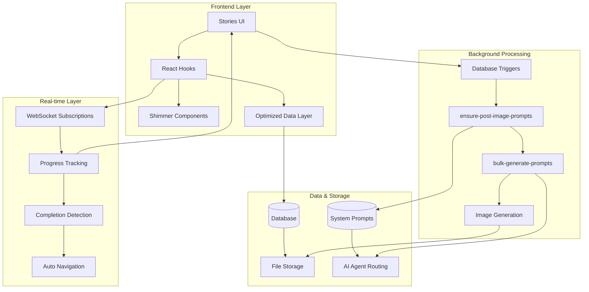
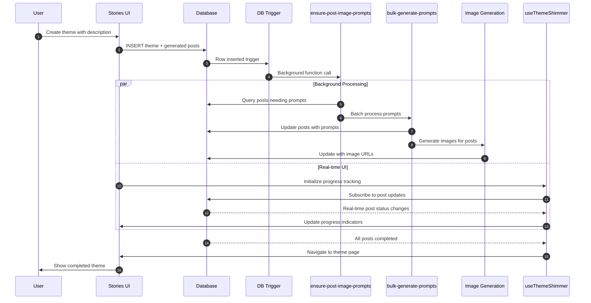
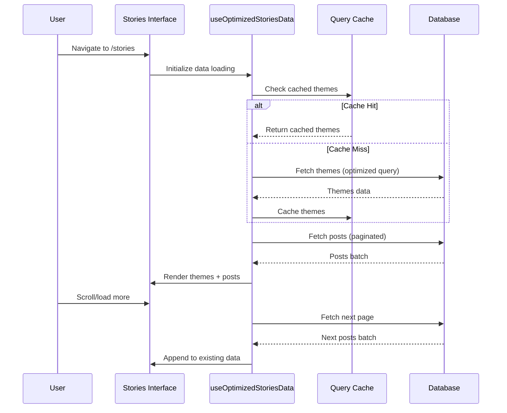
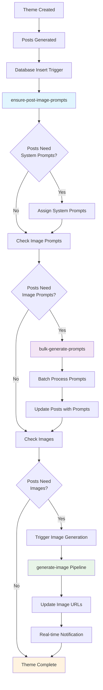
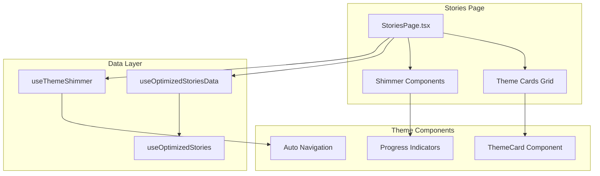

# Stories & Theme Generation System Architecture

**Version:** 1.0  
**Last Updated:** 2025-09-07  
**Audience:** Developers, Engineers, Technical Team

---

## 🎯 Executive Summary

The Stories & Theme Generation System is a comprehensive content creation platform that transforms user theme ideas into complete social media content collections through automated AI-powered workflows. The system emphasizes bulk processing, real-time progress tracking, and seamless user experience through background processing and intelligent caching.

**Quick Navigation:**
- [🏗️ System Architecture](#️-system-architecture)
- [🔄 Complete Flow Diagrams](#-complete-flow-diagrams)
- [🗂️ Component Architecture](#️-component-architecture)
- [🚀 Processing Pipelines](#-processing-pipelines)
- [📊 Database Schema](#-database-schema)
- [⚙️ Integration Patterns](#️-integration-patterns)
- [🛡️ Security & Performance](#️-security--performance)

---

## 🏗️ System Architecture

### High-Level Architecture Overview



### Core System Components

| Layer | Component | Purpose | Key Features |
|-------|-----------|---------|--------------|
| **Frontend** | `useThemeShimmer` | Progress tracking & UX | Real-time updates, shimmer effects, completion detection |
| **Frontend** | `useOptimizedStoriesData` | Data optimization | Pagination, caching, lazy loading |
| **Processing** | `ensure-post-image-prompts` | Background orchestration | Automatic trigger, batch processing |
| **Processing** | `bulk-generate-prompts` | Efficient prompt generation | Batch operations, concurrency control |
| **Real-time** | WebSocket subscriptions | Live updates | Real-time sync, progress streaming |
| **Data** | Optimized queries | Performance | Selective loading, indexed queries |

---

## 🔄 Complete Flow Diagrams

### Theme Creation & Content Generation Flow



### Data Loading & Optimization Flow



### Background Processing Deep Dive



---

## 🗂️ Component Architecture

### Frontend Component Hierarchy



### Hook Integration Patterns

| Hook | Primary Purpose | Key Methods | Integration Points |
|------|----------------|-------------|-------------------|
| `useOptimizedStoriesData` | Data fetching & caching | `themes`, `posts`, `loadMorePosts`, `refreshData` | Main data provider for Stories page |
| `useThemeShimmer` | Real-time progress tracking | `shouldShowShimmer`, `completionProgress`, `dismissShimmer` | Progress indicators and auto-navigation |
| `useOptimizedStories` | Theme-specific data | `availableThemes`, `changeTab`, `invalidateCache` | Theme detail pages and navigation |

### Component Integration Examples

```typescript
// Stories Page Integration
function StoriesPage() {
  const { themes, posts, loading, loadMorePosts } = useOptimizedStoriesData({
    pageSize: 50,
    preloadImages: false
  });
  
  const { shouldShowShimmer, completionProgress } = useThemeShimmer({
    pendingTheme,
    setPendingTheme
  });

  return (
    <div>
      {shouldShowShimmer && <ShimmerEffect progress={completionProgress} />}
      <ThemeGrid themes={themes} posts={posts} />
      <InfiniteScroll onLoadMore={loadMorePosts} />
    </div>
  );
}
```

---

## 🚀 Processing Pipelines

### Bulk Processing Architecture

The system is built around efficient bulk operations that minimize individual API calls and maximize throughput:

#### 1. Theme Creation Pipeline
```
User Input → Theme Creation → Content Generation → 
Background Processing → System Prompt Assignment → 
Bulk Prompt Generation → Image Generation → Completion
```

#### 2. Prompt Processing Pipeline
```
Posts Query → Batch Formation → bulk-generate-prompts → 
OpenAI API (Batch) → Database Updates → Status Tracking
```

#### 3. Image Generation Pipeline
```
Posts with Prompts → Image Requirements Check → 
generate-image (Multiple Aspects) → Storage Upload → 
Database Updates → Real-time Notifications
```

### Edge Function Flow

| Function | Trigger | Input | Output | Next Step |
|----------|---------|--------|--------|-----------|
| `ensure-post-image-prompts` | DB trigger on theme creation | Theme ID, post IDs | Processing status | Calls `bulk-generate-prompts` |
| `bulk-generate-prompts` | Called by `ensure-post-image-prompts` | Post batch, category | Generated prompts | Updates database |
| `generate-image` | Manual/automated trigger | Post ID, aspect ratio | Image URL | Updates post record |

### Real-time Processing Features

- **WebSocket Subscriptions**: Live updates on post status changes
- **Progress Calculation**: Real-time completion percentage tracking
- **Auto Navigation**: Automatic redirect when theme processing completes
- **Optimistic Updates**: UI updates before server confirmation

---

## 📊 Database Schema

### Core Tables

#### `themes` Table
```sql
CREATE TABLE themes (
  id UUID PRIMARY KEY DEFAULT gen_random_uuid(),
  user_id UUID NOT NULL REFERENCES auth.users(id),
  theme_name TEXT NOT NULL,
  description TEXT,
  category TEXT NOT NULL,
  query TEXT NOT NULL,
  created_at TIMESTAMPTZ DEFAULT NOW(),
  updated_at TIMESTAMPTZ DEFAULT NOW(),
  prompt_generation_status TEXT DEFAULT 'not_started'
);
```

#### `social_media_posts` Table
```sql
CREATE TABLE social_media_posts (
  id UUID PRIMARY KEY DEFAULT gen_random_uuid(),
  theme_id UUID NOT NULL REFERENCES themes(id),
  user_id UUID NOT NULL REFERENCES auth.users(id),
  title TEXT NOT NULL,
  description TEXT NOT NULL,
  day INTEGER,
  -- Image URLs for different aspect ratios
  image_1_1_url TEXT,
  image_16_9_url TEXT,
  image_4_3_url TEXT,
  image_9_16_url TEXT,
  image_3_4_url TEXT,
  -- Status tracking
  image_1_1_status TEXT DEFAULT 'pending',
  image_16_9_status TEXT DEFAULT 'pending',
  image_4_3_status TEXT DEFAULT 'pending',
  image_9_16_status TEXT DEFAULT 'pending',
  image_3_4_status TEXT DEFAULT 'pending',
  individual_prompt_status TEXT DEFAULT 'pending',
  generated_image_prompt TEXT,
  status TEXT DEFAULT 'draft',
  created_at TIMESTAMPTZ DEFAULT NOW(),
  updated_at TIMESTAMPTZ DEFAULT NOW()
);
```

#### `theme_system_prompts` Table
```sql
CREATE TABLE theme_system_prompts (
  id UUID PRIMARY KEY DEFAULT gen_random_uuid(),
  theme_id UUID REFERENCES themes(id),
  category TEXT NOT NULL,
  prompt_text TEXT NOT NULL,
  created_at TIMESTAMPTZ DEFAULT NOW(),
  updated_at TIMESTAMPTZ DEFAULT NOW()
);
```

### Database Triggers

#### Theme Processing Trigger
```sql
CREATE OR REPLACE FUNCTION trigger_ensure_post_image_prompts()
RETURNS TRIGGER AS $$
BEGIN
  -- Call edge function asynchronously
  PERFORM net.http_post(
    url := 'https://your-project.supabase.co/functions/v1/ensure-post-image-prompts',
    headers := '{"Authorization": "Bearer ' || current_setting('app.jwt_token') || '"}',
    body := '{"theme_id": "' || NEW.id || '"}'
  );
  RETURN NEW;
END;
$$ LANGUAGE plpgsql;

CREATE TRIGGER ensure_post_image_prompts_trigger
  AFTER INSERT ON themes
  FOR EACH ROW
  EXECUTE FUNCTION trigger_ensure_post_image_prompts();
```

### Optimized Queries

#### Theme with Post Count
```sql
SELECT 
  t.*,
  COUNT(smp.id) as post_count,
  SUM(CASE WHEN smp.individual_prompt_status = 'completed' THEN 1 ELSE 0 END) as prompt_completion_count
FROM themes t
LEFT JOIN social_media_posts smp ON smp.theme_id = t.id
WHERE t.user_id = $1
GROUP BY t.id
ORDER BY t.created_at DESC;
```

#### Posts with Selective Loading
```sql
-- Only load essential fields initially
SELECT theme_id, id, title, description, day, created_at, image_1_1_status
FROM social_media_posts
WHERE theme_id = ANY($1) AND user_id = $2
ORDER BY day ASC NULLS FIRST, created_at ASC
LIMIT $3 OFFSET $4;
```

---

## ⚙️ Integration Patterns

### Frontend Integration Best Practices

#### 1. Data Loading Pattern
```typescript
// Efficient data loading with caching
const { themes, posts, loading, error, refreshData } = useOptimizedStoriesData({
  pageSize: 50,
  preloadImages: false // Load images on-demand
});

// Handle loading states
if (loading) return <StoriesSkeletonLoader />;
if (error) return <ErrorBoundary error={error} />;
```

#### 2. Real-time Updates Pattern
```typescript
// Track processing progress
const { 
  shouldShowShimmer, 
  completionProgress, 
  dismissShimmer 
} = useThemeShimmer({
  pendingTheme,
  setPendingTheme
});

// Auto-navigation on completion
useEffect(() => {
  if (completionProgress.isComplete) {
    navigate(`/themes/${pendingTheme.theme_id}`);
  }
}, [completionProgress.isComplete]);
```

#### 3. Background Processing Pattern
```typescript
// Theme creation with background processing
const createTheme = async (themeData) => {
  // 1. Create theme and posts
  const theme = await supabase.from('themes').insert(themeData).select().single();
  
  // 2. Set up progress tracking
  setPendingTheme({
    theme_id: theme.id,
    theme_name: theme.theme_name,
    description: theme.description
  });
  
  // 3. Background processing happens automatically via triggers
  // 4. Real-time updates via useThemeShimmer
};
```

### Backend Integration Patterns

#### 1. Bulk Processing Pattern
```typescript
// ensure-post-image-prompts edge function
export default async function ensurePostImagePrompts(req: Request) {
  const { theme_id } = await req.json();
  
  // 1. Query posts needing processing
  const posts = await queryPostsNeedingPrompts(theme_id);
  
  // 2. Batch process via bulk-generate-prompts
  if (posts.length > 0) {
    await supabase.functions.invoke('bulk-generate-prompts', {
      body: { posts, theme_id, category }
    });
  }
  
  // 3. Return status
  return new Response(JSON.stringify({ processed: posts.length }));
}
```

#### 2. Real-time Updates Pattern
```typescript
// Database trigger for real-time updates
const setupRealtimeSubscription = () => {
  return supabase
    .channel('social_media_posts')
    .on('postgres_changes', {
      event: 'UPDATE',
      schema: 'public',
      table: 'social_media_posts',
      filter: `theme_id=eq.${themeId}`
    }, (payload) => {
      // Update UI with new post status
      updatePostStatus(payload.new);
    })
    .subscribe();
};
```

---

## 🛡️ Security & Performance

### Security Considerations

#### Row Level Security (RLS)
```sql
-- Themes RLS
CREATE POLICY "Users can view their own themes" ON themes
  FOR SELECT USING (auth.uid() = user_id);

-- Posts RLS  
CREATE POLICY "Users can view their own posts" ON social_media_posts
  FOR SELECT USING (auth.uid() = user_id);
```

#### Edge Function Security
- **JWT Authentication**: All functions require valid user authentication
- **Input Validation**: Comprehensive validation of all inputs
- **Rate Limiting**: Built-in rate limiting for API calls
- **Content Safety**: Prompt validation and content moderation

### Performance Optimizations

#### Database Optimizations
- **Indexes**: Strategic indexes on frequently queried columns
- **Pagination**: Efficient offset-based pagination with limits
- **Selective Loading**: Load only required fields initially
- **Connection Pooling**: Optimized database connection management

#### Frontend Optimizations
- **Lazy Loading**: Load images and non-critical data on-demand
- **Virtual Scrolling**: Handle large datasets efficiently
- **Intelligent Caching**: Cache themes, posts, and system prompts
- **Optimistic Updates**: Update UI before server confirmation

#### Background Processing Optimizations
- **Batch Operations**: Process multiple items simultaneously
- **Async Processing**: Non-blocking background operations
- **Progress Streaming**: Real-time progress updates
- **Error Recovery**: Intelligent retry and recovery mechanisms

### Monitoring & Observability

#### Key Metrics
- **Theme Creation Rate**: Themes created per time period
- **Processing Time**: End-to-end theme completion time
- **Error Rates**: Failed operations and recovery rates
- **User Engagement**: Theme completion and interaction rates

#### Logging & Debugging
- **Structured Logging**: Consistent log format across components
- **Correlation IDs**: Track operations across system boundaries
- **Performance Metrics**: Response times and resource usage
- **Error Tracking**: Comprehensive error capture and analysis

---

## 🔧 Troubleshooting Guide

### Common Issues & Solutions

#### Theme Not Processing
**Symptoms:** Shimmer effect shows but no progress
**Solution:** Check edge function logs for `ensure-post-image-prompts` errors

#### Images Not Generating
**Symptoms:** Prompts complete but images remain pending
**Solution:** Verify `generate-image` function status and OpenAI API availability

#### Real-time Updates Not Working
**Symptoms:** UI not updating with progress
**Solution:** Check WebSocket subscription and database trigger configuration

### Debug Information

#### Enable Debug Mode
```typescript
// Add to useThemeShimmer for detailed logging
const DEBUG_MODE = true;
if (DEBUG_MODE) {
  console.log('Theme processing status:', completionProgress);
}
```

#### Monitor Edge Function Logs
```bash
# View edge function logs
supabase functions logs ensure-post-image-prompts
supabase functions logs bulk-generate-prompts
```

---

This architecture documentation provides a comprehensive overview of the Stories & Theme Generation System, focusing on the bulk processing workflows, real-time updates, and efficient user experience patterns that make the system powerful and responsive.