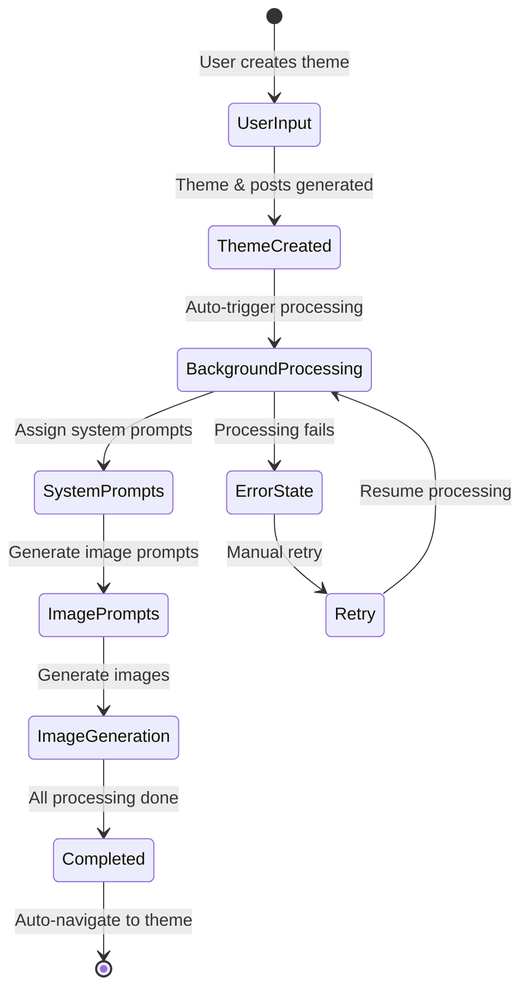
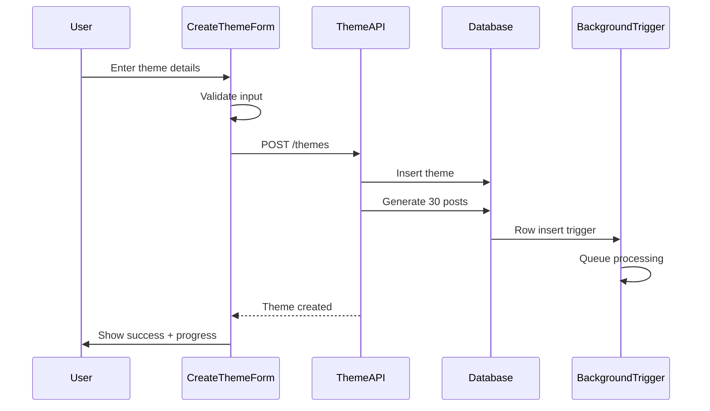
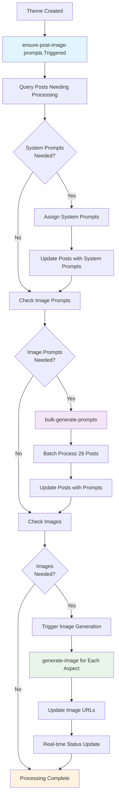

# Theme Lifecycle Management Guide

**Version:** 1.0  
**Last Updated:** 2025-09-07  
**Audience:** Developers, Product Managers, Support Team

---

## 🎯 Overview

This guide details the complete lifecycle of a theme in the Stories & Theme Generation System, from initial user input through content generation, background processing, real-time progress tracking, and final completion with automatic navigation.

**Quick Navigation:**
- [🔄 Complete Theme Lifecycle](#-complete-theme-lifecycle)
- [🚀 Theme Creation Process](#-theme-creation-process)
- [⚙️ Background Processing](#️-background-processing)
- [📊 Progress Tracking & UX](#-progress-tracking--ux)
- [✅ Completion Detection](#-completion-detection)
- [🛠️ Implementation Details](#️-implementation-details)
- [🐛 Troubleshooting](#-troubleshooting)

---

## 🔄 Complete Theme Lifecycle

### Lifecycle States Overview



### Phase Breakdown

| Phase | Duration | UI State | Background Activity | User Experience |
|-------|----------|----------|-------------------|------------------|
| **Creation** | 2-5 seconds | Loading spinner | Theme & post creation | User waits |
| **Processing** | 30-120 seconds | Shimmer effect | System prompts, image prompts, images | Real-time progress |
| **Completion** | Instant | Success state | Database updates | Auto-navigation |
| **Error** | Variable | Error indicators | Retry mechanisms | Error recovery |

---

## 🚀 Theme Creation Process

### User Input to Theme Creation



### Theme Creation Data Flow

#### Input Structure
```typescript
interface CreateThemeRequest {
  theme_name: string;           // "30 Days of Healthcare Tips"
  description: string;          // User's theme description
  category: string;            // "healthcare", "design", etc.
  query: string;               // AI query for content generation
}
```

#### Generated Output
```typescript
interface ThemeCreationResult {
  theme: {
    id: string;
    theme_name: string;
    description: string;
    category: string;
    created_at: string;
    prompt_generation_status: 'not_started' | 'in_progress' | 'completed';
  };
  posts: Array<{
    id: string;
    theme_id: string;
    title: string;
    description: string;
    day: number;
    individual_prompt_status: 'pending';
    status: 'draft';
  }>;
}
```

### Automatic Background Processing Initiation

#### Database Trigger Setup
```sql
CREATE OR REPLACE FUNCTION trigger_ensure_post_image_prompts()
RETURNS TRIGGER AS $$
BEGIN
  -- Async call to ensure-post-image-prompts edge function
  PERFORM net.http_post(
    url := 'https://your-project.supabase.co/functions/v1/ensure-post-image-prompts',
    headers := jsonb_build_object(
      'Authorization', 'Bearer ' || current_setting('request.jwt.claim.sub', true),
      'Content-Type', 'application/json'
    ),
    body := jsonb_build_object('theme_id', NEW.id)::text
  );
  RETURN NEW;
END;
$$ LANGUAGE plpgsql;

CREATE TRIGGER ensure_post_image_prompts_trigger
  AFTER INSERT ON themes
  FOR EACH ROW
  EXECUTE FUNCTION trigger_ensure_post_image_prompts();
```

---

## ⚙️ Background Processing

### Processing Pipeline Overview



### Stage 1: System Prompt Assignment

#### Purpose
Assign appropriate AI agents and system prompts based on theme category.

#### Implementation
```typescript
// ensure-post-image-prompts edge function
async function assignSystemPrompts(themeId: string, category: string) {
  // 1. Check if theme already has system prompts
  const existingPrompts = await supabase
    .from('theme_system_prompts')
    .select('*')
    .eq('theme_id', themeId);
    
  if (existingPrompts.data?.length === 0) {
    // 2. Call system prompt agent to get appropriate prompt
    const systemPrompt = await supabase.functions.invoke('create-theme-system-prompt', {
      body: { category, themeId }
    });
    
    // 3. Store system prompt
    await supabase
      .from('theme_system_prompts')
      .insert({
        theme_id: themeId,
        category,
        prompt_text: systemPrompt.data.prompt
      });
  }
}
```

### Stage 2: Image Prompt Generation

#### Purpose
Generate optimized image prompts for all posts in the theme using bulk processing.

#### Implementation
```typescript
// bulk-generate-prompts processing
async function generateImagePrompts(posts: Post[], category: string) {
  console.log(`🚀 Processing batch of ${posts.length} prompts for theme ${themeId}`);
  
  // Process in batches for efficiency
  const batchSize = 26; // Optimal batch size
  const batches = chunk(posts, batchSize);
  
  for (const batch of batches) {
    const results = await Promise.allSettled(
      batch.map(post => processIndividualPrompt(post, category))
    );
    
    // Update database with results
    await updatePostsWithPrompts(results);
  }
  
  console.log(`✅ Batch complete: ${successCount} success, ${failCount} failed`);
}
```

### Stage 3: Image Generation

#### Purpose
Generate images for all aspect ratios (1:1, 16:9, 4:3, 9:16, 3:4) for posts with prompts.

#### Implementation Flow
1. **Query posts** with `individual_prompt_status = 'completed'` and missing images
2. **Generate images** for each required aspect ratio
3. **Upload to storage** with deterministic naming
4. **Update database** with image URLs and status
5. **Notify real-time subscribers** of progress

---

## 📊 Progress Tracking & UX

### Real-time Progress System

#### useThemeShimmer Hook
```typescript
export const useThemeShimmer = ({ pendingTheme, setPendingTheme }) => {
  const [themePosts, setThemePosts] = useState<SocialMediaPost[]>([]);
  const [shouldShowShimmer, setShouldShowShimmer] = useState(false);
  
  // Set up real-time subscription
  useEffect(() => {
    if (!pendingTheme?.theme_id) return;
    
    const subscription = supabase
      .channel('social_media_posts')
      .on('postgres_changes', {
        event: 'UPDATE',
        schema: 'public',
        table: 'social_media_posts',
        filter: `theme_id=eq.${pendingTheme.theme_id}`
      }, (payload) => {
        // Update post status in real-time
        setThemePosts(prev => prev.map(post => 
          post.id === payload.new.id ? { ...post, ...payload.new } : post
        ));
      })
      .subscribe();
      
    return () => subscription.unsubscribe();
  }, [pendingTheme?.theme_id]);
  
  // Calculate completion progress
  const completionProgress = useMemo(() => {
    if (!pendingTheme || themePosts.length === 0) {
      return { isComplete: false, percentage: 0, completedCount: 0, totalCount: 0 };
    }
    
    const completed = areAllPostPromptsCompleted(themePosts);
    const completedCount = themePosts.filter(post => 
      post.individual_prompt_status === 'completed'
    ).length;
    
    return {
      isComplete: completed,
      percentage: Math.round((completedCount / themePosts.length) * 100),
      completedCount,
      totalCount: themePosts.length
    };
  }, [themePosts, pendingTheme]);
  
  return {
    shouldShowShimmer,
    completionProgress,
    dismissShimmer: () => setShouldShowShimmer(false)
  };
};
```

### Progress UI Components

#### Shimmer Effect Component
```typescript
interface ShimmerEffectProps {
  progress: {
    percentage: number;
    completedCount: number;
    totalCount: number;
  };
  themeName: string;
}

function ShimmerEffect({ progress, themeName }: ShimmerEffectProps) {
  return (
    <div className="fixed inset-0 bg-black/50 flex items-center justify-center z-50">
      <div className="bg-white rounded-lg p-6 max-w-md mx-4">
        <div className="text-center">
          <h3 className="text-lg font-semibold mb-2">
            Processing "{themeName}"
          </h3>
          <p className="text-gray-600 mb-4">
            Generating content and images...
          </p>
          
          {/* Progress bar */}
          <div className="w-full bg-gray-200 rounded-full h-2 mb-2">
            <div 
              className="bg-blue-600 h-2 rounded-full transition-all duration-300"
              style={{ width: `${progress.percentage}%` }}
            />
          </div>
          
          <p className="text-sm text-gray-500">
            {progress.completedCount} of {progress.totalCount} posts ready
          </p>
        </div>
      </div>
    </div>
  );
}
```

---

## ✅ Completion Detection

### Completion Logic

#### Post Completion Check
```typescript
export const areAllPostPromptsCompleted = (posts: SocialMediaPost[]): boolean => {
  if (!posts || posts.length === 0) return false;
  
  return posts.every(post => {
    // Check if post has individual prompt
    const hasPrompt = post.individual_prompt_status === 'completed';
    
    // Optional: Check if basic images are generated
    const hasBasicImage = post.image_1_1_status === 'completed' || 
                         post.image_1_1_url;
    
    return hasPrompt; // Add "&& hasBasicImage" if images required
  });
};
```

#### Auto-Navigation Implementation
```typescript
// In useThemeShimmer hook
useEffect(() => {
  if (!pendingTheme || !completionProgress.isComplete) return;
  
  // Small delay to ensure UI updates are complete
  const timer = setTimeout(() => {
    // Clear pending theme state
    setPendingTheme(null);
    
    // Navigate to completed theme
    navigate(`/themes/${pendingTheme.theme_id}`);
    
    // Show success notification
    toast.success(`"${pendingTheme.theme_name}" is ready!`, {
      description: "All content has been generated successfully.",
      duration: 5000
    });
  }, 1000);
  
  return () => clearTimeout(timer);
}, [completionProgress.isComplete, pendingTheme, navigate, setPendingTheme]);
```

### Completion States

| State | Criteria | UI Behavior | Next Action |
|-------|----------|-------------|-------------|
| **In Progress** | Some posts still processing | Show shimmer with progress | Continue monitoring |
| **Completed** | All posts have prompts/images | Hide shimmer, show success | Auto-navigate to theme |
| **Partial Complete** | Most posts done, some failed | Show partial success state | Allow manual retry |
| **Failed** | Processing failed entirely | Show error state | Provide retry option |

---

## 🛠️ Implementation Details

### Key Database Operations

#### Query Posts Needing Processing
```sql
-- Posts needing system prompts
SELECT id, theme_id, title, description, category
FROM social_media_posts smp
JOIN themes t ON t.id = smp.theme_id
WHERE smp.theme_id = $1 
  AND smp.individual_prompt_status = 'pending'
  AND NOT EXISTS (
    SELECT 1 FROM theme_system_prompts tsp 
    WHERE tsp.theme_id = smp.theme_id
  );

-- Posts needing image prompts  
SELECT id, title, description, day
FROM social_media_posts
WHERE theme_id = $1 
  AND individual_prompt_status = 'pending'
  AND generated_image_prompt IS NULL;

-- Posts needing images
SELECT id, generated_image_prompt
FROM social_media_posts
WHERE theme_id = $1
  AND individual_prompt_status = 'completed'
  AND (image_1_1_url IS NULL OR image_16_9_url IS NULL);
```

#### Batch Update Operations
```sql
-- Update posts with generated prompts
UPDATE social_media_posts 
SET 
  generated_image_prompt = data.prompt,
  individual_prompt_status = 'completed',
  updated_at = NOW()
FROM (VALUES 
  ('post-id-1', 'Generated prompt 1'),
  ('post-id-2', 'Generated prompt 2')
) AS data(id, prompt)
WHERE social_media_posts.id = data.id::uuid;

-- Update posts with image URLs
UPDATE social_media_posts
SET 
  image_1_1_url = data.url,
  image_1_1_status = 'completed',
  updated_at = NOW()
FROM (VALUES
  ('post-id-1', 'https://storage.url/image1.jpg'),
  ('post-id-2', 'https://storage.url/image2.jpg')
) AS data(id, url)
WHERE social_media_posts.id = data.id::uuid;
```

### Performance Optimizations

#### Efficient Data Loading
```typescript
// useOptimizedStoriesData optimization
const fetchPosts = async (page: number = 0, append: boolean = false) => {
  // Only load essential fields initially
  const selectFields = preloadImages 
    ? 'theme_id, id, title, description, day, created_at, image_1_1_url, image_1_1_status'
    : 'theme_id, id, title, description, day, created_at, image_1_1_status';
    
  const { data, error } = await supabase
    .from('social_media_posts')
    .select(selectFields)
    .in('theme_id', themeIds)
    .eq('user_id', userId)
    .neq('status', 'deleted')
    .order('day', { ascending: true, nullsFirst: false })
    .range(page * pageSize, (page + 1) * pageSize - 1);
};

// Load additional image data on-demand
const loadImageData = async (postId: string) => {
  const { data } = await supabase
    .from('social_media_posts')
    .select('image_16_9_url, image_4_3_url, image_9_16_url, image_3_4_url')
    .eq('id', postId)
    .single();
    
  // Update specific post with image data
  setPosts(prev => prev.map(post => 
    post.id === postId ? { ...post, ...data } : post
  ));
};
```

---

## 🐛 Troubleshooting

### Common Issues & Solutions

#### Theme Stuck in Processing
**Symptoms:**
- Shimmer effect shows indefinitely
- Progress doesn't advance beyond certain percentage
- No error messages displayed

**Diagnosis:**
```typescript
// Check processing status
const debugThemeProcessing = async (themeId: string) => {
  // 1. Check theme status
  const theme = await supabase
    .from('themes')
    .select('*')
    .eq('id', themeId)
    .single();
    
  // 2. Check posts status
  const posts = await supabase
    .from('social_media_posts')
    .select('id, individual_prompt_status, image_1_1_status')
    .eq('theme_id', themeId);
    
  // 3. Check system prompts
  const systemPrompts = await supabase
    .from('theme_system_prompts')
    .select('*')
    .eq('theme_id', themeId);
    
  console.log('Debug info:', { theme, posts, systemPrompts });
};
```

**Solutions:**
1. **Check edge function logs**: `supabase functions logs ensure-post-image-prompts`
2. **Verify database triggers**: Ensure trigger is properly configured
3. **Manual retry**: Call `ensure-post-image-prompts` manually with theme ID
4. **Reset processing**: Update theme status to allow reprocessing

#### Real-time Updates Not Working
**Symptoms:**
- Progress bar doesn't update
- Completion detection fails
- No automatic navigation

**Solutions:**
```typescript
// Verify subscription setup
const testRealtimeConnection = () => {
  const subscription = supabase
    .channel('test-connection')
    .on('postgres_changes', {
      event: '*',
      schema: 'public',
      table: 'social_media_posts'
    }, (payload) => {
      console.log('Real-time update received:', payload);
    })
    .subscribe((status) => {
      console.log('Subscription status:', status);
    });
};

// Check network connectivity
if (navigator.onLine) {
  console.log('Online - real-time should work');
} else {
  console.log('Offline - real-time disabled');
}
```

#### Background Processing Failures
**Symptoms:**
- `ensure-post-image-prompts` function errors
- Posts remain in `pending` status
- Bulk processing doesn't start

**Debug Steps:**
1. **Check function logs**:
   ```bash
   supabase functions logs ensure-post-image-prompts --follow
   ```

2. **Verify function permissions**:
   ```sql
   -- Check RLS policies allow function access
   SELECT * FROM themes WHERE id = 'theme-id' AND user_id = 'user-id';
   ```

3. **Manual function call**:
   ```typescript
   const manualTrigger = await supabase.functions.invoke('ensure-post-image-prompts', {
     body: { theme_id: 'failing-theme-id' }
   });
   ```

### Debug Tools

#### Enable Debug Logging
```typescript
// Add to useThemeShimmer
const DEBUG_THEME_PROCESSING = process.env.NODE_ENV === 'development';

if (DEBUG_THEME_PROCESSING) {
  console.log('Theme processing debug:', {
    pendingTheme,
    themePosts: themePosts.length,
    completionProgress,
    shouldShowShimmer
  });
}
```

#### Monitor Processing Pipeline
```typescript
// Monitor edge function calls
const monitorEdgeFunctions = () => {
  // Monitor ensure-post-image-prompts
  supabase.functions.invoke('ensure-post-image-prompts', {
    body: { theme_id, debug: true }
  }).then(result => {
    console.log('ensure-post-image-prompts result:', result);
  });
};
```

---

This guide provides comprehensive coverage of the theme lifecycle, from creation through completion, with detailed implementation examples and troubleshooting guidance for maintaining a smooth user experience throughout the processing pipeline.