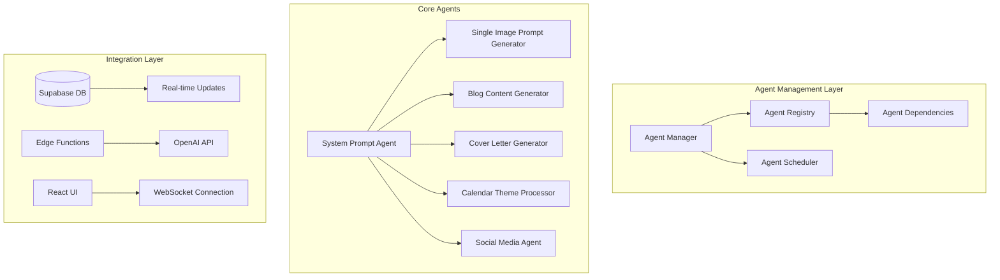

# AI Agent System Documentation

## Overview

This directory contains comprehensive documentation for the AI Agent System, a sophisticated multi-agent platform built on OpenAI's latest models (GPT-5, O3, O4) and integrated with Supabase for real-time data management.

## Architecture

### System Components



### Technology Stack

| Component | Technology | Version | Purpose |
|-----------|------------|---------|---------|
| **AI Models** | OpenAI GPT-5, O3, O4 | 2025 Release | Core AI processing |
| **Database** | Supabase PostgreSQL | Latest | Data persistence & real-time |
| **Backend** | Supabase Edge Functions | Deno Runtime | Serverless API layer |
| **Frontend** | React + TypeScript | 18.x | User interface |
| **State Management** | React Query + Zustand | Latest | Data & UI state |
| **Real-time** | Supabase WebSocket | Native | Live updates |

## Agent Categories

### Core Processing Agents
- **[System Prompt Agent](./system-prompt-agent.md)** - Central orchestrator and prompt router
- **[Bulk Prompt Generator](./bulk-generate-prompts.md)** - Batch image prompt generation
- **[Blog Content Generator](./blog-content-generator.md)** - Long-form content creation
- **[Cover Letter Generator](./cover-letter-generator.md)** - Professional document generation
- **[Social Media Agent](./social-media-agent.md)** - Multi-platform social content

### Utility Agents
- **[Calendar Theme Processor](./calendar-theme-processor.md)** - JSON data processing and validation

### System Components
- **[Agent Relationships](./agent-relationships.md)** - Dependency management system
- **[Agent Deployment Templates](./agent-deployment-templates.md)** - Pre-configured agent setups
- **[Performance Monitoring](./performance-monitoring.md)** - Metrics and analytics

## Quick Start

### Creating an Agent

```typescript
import { useCreateAgent } from '@/hooks/useOpenAIAgents';

const { mutate: createAgent } = useCreateAgent();

createAgent({
  name: "Content Generator",
  purpose: "Generate marketing content",
  model_version: "gpt-5-2025-08-07",
  trigger: "api_call",
  input_source: "user_prompt",
  output_target: "database",
  schedule: "on_demand",
  owner: "marketing_team",
  status: "active",
  supported_categories: ["marketing", "content"],
  temperature: 1, // Note: GPT-5 uses fixed temperature
  max_tokens: 5000
});
```

### Agent Configuration

```typescript
// Model Parameter Differences
const gpt5Config = {
  model_version: "gpt-5-2025-08-07",
  max_completion_tokens: 5000, // Use max_completion_tokens for GPT-5
  // temperature not supported - defaults to 1.0
};

const legacyConfig = {
  model_version: "gpt-4o",
  max_tokens: 5000, // Use max_tokens for legacy models
  temperature: 0.7 // Supported in legacy models
};
```

## Integration Patterns

### Database Schema
```sql
-- Core agent table
CREATE TABLE openai_agents (
  id uuid PRIMARY KEY DEFAULT gen_random_uuid(),
  user_id uuid NOT NULL REFERENCES auth.users,
  name text NOT NULL,
  purpose text NOT NULL,
  model_version text NOT NULL,
  status agent_status DEFAULT 'active',
  system_prompts jsonb DEFAULT '[]'::jsonb,
  supported_categories text[] DEFAULT '{}',
  created_at timestamptz DEFAULT now(),
  updated_at timestamptz DEFAULT now()
);

-- Agent relationships for dependencies
CREATE TABLE agent_relationships (
  id uuid PRIMARY KEY DEFAULT gen_random_uuid(),
  source_agent_id uuid NOT NULL REFERENCES openai_agents,
  target_agent_id uuid NOT NULL REFERENCES openai_agents,
  relationship_type text DEFAULT 'dependency',
  is_required boolean DEFAULT true
);
```

### Real-time Updates
```typescript
// WebSocket integration for live agent status
const { data: agents } = useOpenAIAgents();
// Automatically receives real-time updates via Supabase subscriptions
```

## Performance Guidelines

### Model Selection
- **GPT-5**: Use for complex reasoning and high-quality output
- **O3**: Use for multi-step analytical tasks
- **O4-Mini**: Use for fast, efficient processing
- **Legacy Models**: Only when specific features required

### Optimization Strategies
- Cache frequently accessed prompts
- Use batch processing for multiple operations
- Implement proper error handling and retries
- Monitor token usage and costs

### Rate Limiting
```typescript
// Built-in rate limiting per agent
const rateLimits = {
  requests_per_minute: 60,
  tokens_per_hour: 150000,
  concurrent_requests: 10
};
```

## Security & Compliance

### Access Control
- User-scoped agent access via Row Level Security
- API key protection in Supabase Edge Functions
- Audit trails for all agent operations

### Data Protection
- Encrypted prompt storage
- User data isolation
- GDPR/CCPA compliance measures

## Monitoring & Analytics

### Key Metrics
- Agent performance (latency, success rate, token usage)
- User engagement and satisfaction
- Cost optimization and efficiency
- Error patterns and resolution

### Alerting
- Performance degradation alerts
- Error rate threshold notifications
- Cost anomaly detection
- Security incident reporting

## Development Workflow

### 1. Agent Design
- Define agent purpose and scope
- Select appropriate model and parameters
- Design input/output schemas
- Plan integration points

### 2. Implementation
- Create agent configuration
- Implement edge functions if needed
- Add database schemas
- Build UI components

### 3. Testing
- Unit tests for agent logic
- Integration tests with database
- Performance testing
- Security validation

### 4. Deployment
- Deploy via Supabase Edge Functions
- Configure monitoring and alerts
- Document usage patterns
- Train users on new capabilities

## Troubleshooting

### Common Issues
1. **Model Parameter Errors**: Check GPT-5 vs legacy parameter differences
2. **Authentication Failures**: Verify RLS policies and user permissions
3. **Performance Issues**: Review token usage and model selection
4. **Integration Problems**: Check WebSocket connections and caching

### Debug Tools
- Supabase Edge Function logs
- Real-time database monitoring
- Performance analytics dashboard
- Error tracking and reporting

## Contributing

### Adding New Agents
1. Follow the [agent documentation template](./agent-documentation-template.md)
2. Update routing logic in System Prompt Agent
3. Add comprehensive documentation
4. Include performance benchmarks
5. Add monitoring and alerting

### Code Standards
- TypeScript strict mode
- Comprehensive error handling
- Performance optimization
- Security best practices
- Complete documentation

## Support

For technical support and questions:
- Review specific agent documentation
- Check troubleshooting guides
- Submit issues with detailed context
- Follow development best practices

---

*Last updated: 2025 - Version 2.0*