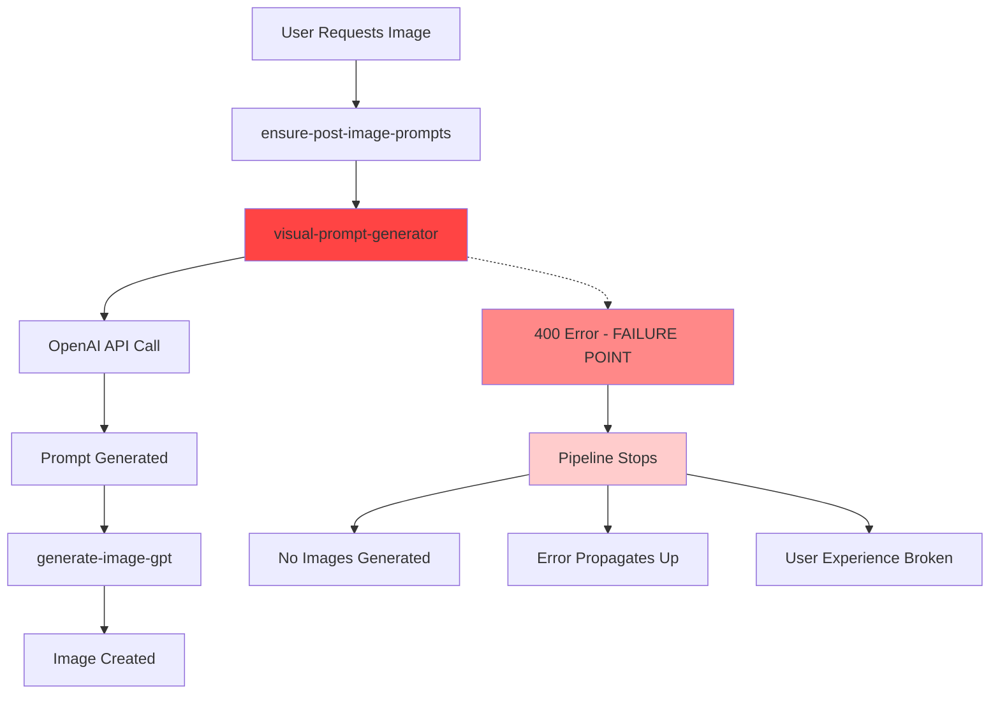

# Core Issues Impact Analysis - Visual Prompt Generator Failures

## Executive Summary

The `visual-prompt-generator` function failure is the **primary bottleneck** causing complete system breakdown in text-to-image creation. This single point of failure creates a cascading effect that impacts every downstream process in the image generation pipeline.

## Core Issue: Visual Prompt Generator Function Failures

### Primary Problem
- **Function:** `visual-prompt-generator`
- **Status:** 🔴 Complete failure
- **Error Pattern:** All requests returning 400 Bad Request
- **Scope:** 100% failure rate across all categories and users

### Root Cause Analysis

#### 1. Parameter Structure Mismatch
The function expects a specific payload structure that differs from what calling functions provide:

**Expected by visual-prompt-generator:**
```json
{
  "category": "string",
  "context": "string", 
  "theme": "string",
  "description": "string",
  "aspect_ratio": "string"
}
```

**Actually sent by ensure-post-image-prompts:**
```json
{
  "category": "string",
  "context": "string",
  "themeId": "uuid",
  "description": "string"
}
```

**Critical Mismatches:**
- `theme` vs `themeId` - Different data types (string vs UUID)
- Missing `aspect_ratio` parameter
- Field naming inconsistencies

#### 2. Response Field Mapping Issues
- Function returns `image_prompt` field
- Calling functions expect `generatedPrompt` field
- Results in null/undefined values even when function succeeds

## Cascading Impact Analysis

### Tier 1 Impact: Direct Function Failures
```
visual-prompt-generator FAILS
    ↓
ensure-post-image-prompts FAILS
    ↓
All 7 posts in level-5-leadership fail prompt generation
```

### Tier 2 Impact: Pipeline Breakdown
```
No Image Prompts Generated
    ↓
generate-image-gpt-optimized has no input
    ↓
No images can be created for any posts
    ↓
Complete image generation pipeline failure
```

### Tier 3 Impact: User Experience Degradation
```
No Visual Content
    ↓
Social Media Posts have no images
    ↓
Reduced engagement and content quality
    ↓
Platform value proposition compromised
```

### Tier 4 Impact: Business Operations
```
Content Creation Workflow Broken
    ↓
Manual intervention required for all image generation
    ↓
Increased operational costs and time
    ↓
Scalability bottleneck
```

## Affected System Components

### Direct Dependencies
1. **ensure-post-image-prompts** - Cannot generate prompts for posts
2. **bulk-generate-single-aspect** - Cannot process bulk image requests
3. **generate-all-images-optimized** - Cannot create multi-aspect images
4. **user-idea-streaming-image-pipeline** - Pipeline stalls at prompt generation

### Indirect Dependencies
1. **BlogVisualPrompt Component** - UI becomes non-functional
2. **useOptimizedImageGeneration Hook** - All image generation requests fail
3. **Social Media Post Management** - Posts remain without visual content
4. **Theme-based Content Generation** - Theme integration fails

### Database Impact
1. **social_media_posts table** - `generated_image_prompt` fields remain NULL
2. **cached_prompts table** - No new prompt caching occurs
3. **api_usage_tracking table** - Inflated error counts, skewed metrics

## System-Wide Effects

### Performance Impact
- **Timeout Cascades:** Failed requests trigger retry mechanisms across multiple functions
- **Resource Waste:** Multiple function instances spawn and fail repeatedly
- **Connection Pool Exhaustion:** Failed API calls consume connection resources

### Data Integrity Impact
- **Incomplete Records:** Posts created without associated image prompts
- **Broken Relationships:** Theme-prompt relationships not established
- **Cache Pollution:** Failed attempts may create invalid cache entries

### Monitoring and Alerting Impact
- **Alert Fatigue:** 100% error rates trigger constant notifications
- **Metric Distortion:** Success rates across entire pipeline show 0%
- **Debugging Complexity:** Single root cause manifests as multiple symptoms

## Critical Path Analysis



## Dependency Chain Failure

### High-Level Flow
1. **Content Creation** → Posts need visual content
2. **Prompt Generation** → **[FAILS HERE]** → visual-prompt-generator breakdown
3. **Image Generation** → Never reached due to missing prompts
4. **Storage & Display** → No images to store or display

### Technical Flow
1. **API Request** → Function parameter validation fails
2. **Error Response** → 400 Bad Request returned
3. **Retry Logic** → Multiple failed attempts consume resources
4. **Timeout Handling** → Eventually gives up, returns error to user

## Risk Assessment

### Immediate Risks (High Priority)
- **Complete Service Disruption:** No new visual content can be created
- **User Abandonment:** Core functionality unavailable
- **Data Loss:** Failed attempts may not be properly logged

### Short-term Risks (Medium Priority)
- **Resource Exhaustion:** Continued failed attempts drain system resources
- **Reputation Damage:** Users perceive platform as unreliable
- **Technical Debt:** Workarounds may introduce additional complexity

### Long-term Risks (Low Priority)
- **Scaling Issues:** Unresolved root cause prevents horizontal scaling
- **Integration Problems:** Future features depending on image generation will fail
- **Maintenance Burden:** Multiple symptoms require ongoing attention

## Resolution Priority Matrix

### Critical Path (Must Fix First)
1. **visual-prompt-generator parameter structure** - Fixes 100% of failures
2. **Response field mapping** - Ensures successful data flow
3. **Error handling improvement** - Provides better debugging information

### Supporting Fixes (Fix Second)
1. **Parameter validation** - Prevents similar issues in future
2. **Integration testing** - Catches mismatches before deployment
3. **Monitoring enhancement** - Better visibility into failure patterns

### System Improvements (Fix Third)
1. **Circuit breaker patterns** - Prevents cascade failures
2. **Graceful degradation** - System continues operating with reduced functionality
3. **Comprehensive logging** - Easier troubleshooting for future issues

## Success Criteria for Resolution

### Immediate Success Indicators
- [ ] visual-prompt-generator returns 200 OK responses
- [ ] ensure-post-image-prompts successfully processes all posts
- [ ] Generated prompts appear in database with correct field names

### System Recovery Indicators
- [ ] End-to-end image generation pipeline functional
- [ ] Batch processing of existing posts without prompts successful
- [ ] User-facing image generation features operational

### Long-term Health Indicators
- [ ] Error rates return to normal baseline (<1%)
- [ ] Resource utilization optimized
- [ ] New posts automatically receive image prompts

---

**Analysis Date:** August 25, 2025  
**Severity:** Critical - System Down  
**Estimated Fix Time:** 2-4 hours (parameter fixes)  
**Estimated Recovery Time:** 4-8 hours (including bulk prompt regeneration)  
**Business Impact:** High - Core functionality unavailable