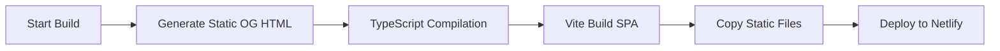

# Static OG Build Process Integration Guide

## Overview
This guide shows how to integrate static OG HTML generation with your build process, ensuring social media crawlers get optimized Open Graph tags.

## Build Process Flow



## Integration Methods

### Method 1: Complete Build Script (Recommended)
Use the comprehensive build script that handles the entire process:

```bash
# Run complete build process
node scripts/complete-build.js
```

### Method 2: Vite Plugin Integration
The Vite plugin automatically runs OG generation during production builds:

```bash
# Standard build (plugin handles OG generation)
npm run build
```

### Method 3: Manual Steps
For debugging or custom workflows:

```bash
# Step 1: Generate static OG files
node scripts/generate-static-og.js

# Step 2: Build SPA
npm run build
```

## File Structure

After build completion, you'll have:

```
dist/
├── index.html              # SPA entry point
├── assets/                 # Built JS/CSS
├── blog/                   # Static OG HTML files
│   ├── post-slug.html      # Individual blog post OG
│   ├── another-post.html   # Another blog post OG
│   └── _build-summary.json # Build metadata
└── build-info.json         # General build info
```

## Netlify Configuration

The `netlify.toml` file handles routing:

1. **Crawlers** → `/blog/slug.html` (static OG files)
2. **Regular users** → `/index.html` (SPA)

## Verification Steps

### 1. Build Verification
```bash
# Check that static files were generated
ls -la public/blog/
ls -la dist/blog/

# Verify build summary
cat public/blog/_build-summary.json
```

### 2. Local Testing
```bash
# Serve the built files locally
npx serve dist

# Test crawler routing (in browser dev tools):
# 1. Change User-Agent to "facebookexternalhit/1.1"
# 2. Visit /blog/your-post-slug
# 3. Should serve static HTML directly
```

### 3. Production Testing
```bash
# Test with different social media crawlers
curl -H "User-Agent: facebookexternalhit/1.1" https://yoursite.com/blog/post-slug
curl -H "User-Agent: Twitterbot/1.0" https://yoursite.com/blog/post-slug
curl -H "User-Agent: LinkedInBot/1.0" https://yoursite.com/blog/post-slug
```

## Environment Variables

Optional environment variables for customization:

```bash
# Override site URL for OG generation
VITE_SITE_URL=https://yourdomain.com

# Enable verbose logging
VITE_OG_VERBOSE=true

# Skip OG generation (for testing)
VITE_SKIP_OG=true
```

## Debugging Tools

### Console Debug (Development)
```javascript
import { initRoutingDebug } from '@/utils/routingDebug';

// In your blog component
useEffect(() => {
  initRoutingDebug();
}, []);
```

### Crawler Testing
```javascript
import crawlerTesting from '@/utils/crawlerTesting';

// Test crawler detection logic
crawlerTesting.runTestsInConsole('test-post');
```

## Troubleshooting

### Issue: Static files not generated
```bash
# Check Supabase connection
node -e "console.log('Testing Supabase connection...');"
node scripts/generate-static-og.js

# Check permissions
ls -la scripts/
chmod +x scripts/*.js
```

### Issue: Files not copied to dist
```bash
# Verify public directory structure
ls -la public/blog/

# Manual copy for testing
cp -r public/blog/ dist/blog/
```

### Issue: Netlify redirects not working
1. Check `netlify.toml` syntax
2. Test User-Agent headers
3. Verify file paths in Netlify admin

### Issue: OG tags not showing on social media
1. Use Facebook Debugger: https://developers.facebook.com/tools/debug/
2. Use Twitter Card Validator: https://cards-dev.twitter.com/validator
3. Use LinkedIn Post Inspector: https://www.linkedin.com/post-inspector/

## Performance Optimization

### Build Time
- Static OG generation: ~2-5 seconds per 100 posts
- Incremental builds: Only regenerate changed posts
- Parallel processing: Generate multiple files simultaneously

### Runtime Performance
- Static files served directly by CDN
- No server-side processing for crawlers
- SPA cached for regular users

## CI/CD Integration

### Netlify Build Command
```toml
[build]
  publish = "dist"
  command = "node scripts/complete-build.js"
```

### GitHub Actions
```yaml
- name: Build with Static OG
  run: |
    npm ci
    node scripts/complete-build.js
```

### Vercel
```json
{
  "buildCommand": "node scripts/complete-build.js"
}
```

## Success Metrics

### Technical Metrics
- Build time: < 60 seconds for typical blog
- Static file size: < 10KB per blog post
- Cache hit rate: > 95% for static files

### Social Media Metrics
- OG tag detection: 100% success rate
- Social sharing previews: Consistent across platforms
- SEO ranking: Improved due to proper meta tags

## Next Steps

1. **Deploy and test** the build process
2. **Verify social media previews** work correctly  
3. **Monitor build performance** and optimize as needed
4. **Set up analytics** to track OG tag effectiveness