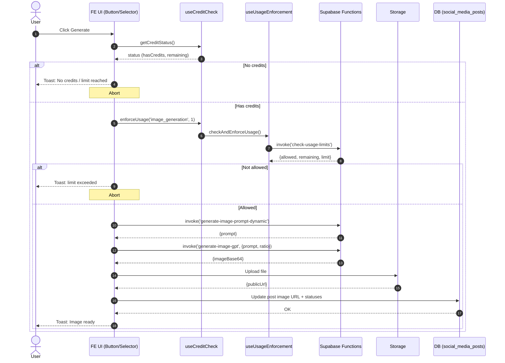
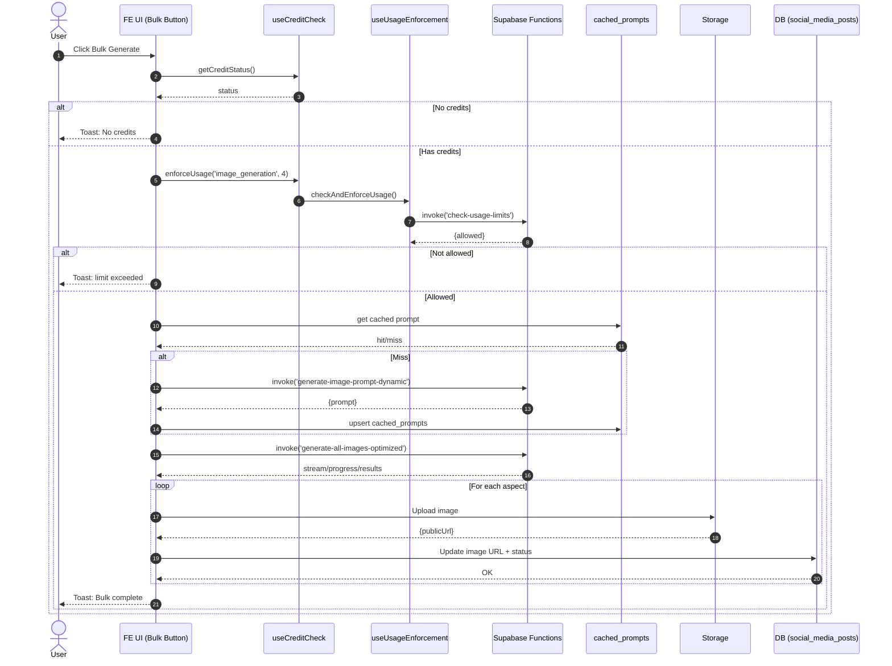

# Text-to-Photos End-to-End Flow — Audit and Hardening Guide

Version: 1.0
Owner: Engineering
Last updated: 2025-08-11

---

## Executive Summary

This document audits and hardens the complete “enter text → get photos” experience across single-image, bulk-generation, and manual upload paths. It enumerates each step, dependency, data contract, state transition, and failure mode, then provides a hardening checklist with prioritized actions.

In scope:
- Single-image generation (hooks, UI actions, backend functions)
- Bulk image generation (prompt caching, progress, batching)
- Manual upload and watermarking paths
- Usage enforcement and credits (daily/monthly, 80% alerts)
- Storage lifecycle (upload, transform, public URLs)
- Database updates and statuses
- Observability, logging, and incident runbooks
- Security, RLS, and secrets

Out of scope:
- Non-image content generation
- External billing integrations

---

## Components and Actors

Frontend (React + TS):
- Hooks
  - src/hooks/useImageGeneration.ts — Orchestrates hero image generation (single image)
  - src/hooks/useImageManager.ts — General image generation and upload manager
  - src/hooks/useImageBatchGeneration.ts — Bulk image generation orchestration, prompt caching
  - src/hooks/useUsageEnforcement.ts — Usage limit checks and alerting
  - src/hooks/useCreditCheck.ts — Exposes credit status and wraps enforcement
- UI Components
  - src/components/stories/GenerateImage.tsx — Uploads and AI-generate entry point
  - src/components/stories/SingleAspectRatioSelector.tsx — Per-aspect ratio generation controls
  - src/components/stories/BulkImageGenerationButton.tsx — Bulk generate action and progress
  - src/components/stories/BulkGenerationThumbnails.tsx — Preview of bulk outputs
- Context
  - ProcessingStatesContext — Tracks isGenerating, bulk states, etc.
- Utilities
  - src/utils/imageUpload.ts — Upload/delete/URL transform helpers
  - src/utils/storageImageUpload.ts — URL → Storage uploader + public URL

Supabase Edge Functions (Server):
- generate-image-prompt-dynamic — Creates prompts from post content
- generate-image-gpt — Generates images from prompts (base64)
- generate-all-images-optimized — Bulk pipeline (multi-aspect)
- streaming-image-pipeline — Streaming image pipeline (SSE/SSE-like)
- check-usage-limits — Enforces per-user daily/monthly usage
- get-usage-summary — Summarizes usage limits/usage
- send-usage-alert — Emails when approaching limits (≥80%)

Database and Storage:
- Tables
  - social_media_posts — Holds posts + image URL fields per aspect ratio
  - cached_prompts — Prompt caching for bulk
  - api_usage_tracking (+ aggregates) — Usage + cost tracking (read-only from FE)
- Storage Buckets
  - Application images buckets (e.g., hero-parallax; post images bucket) with public URLs

External Services:
- OpenAI (image generation), configured through Edge Functions

---

## Dependency Matrix (High-Level)

Runtime:
- React 18, Vite, Tailwind, TypeScript
- Supabase JS SDK ^2.53.0 for Auth, DB, Storage, Edge Functions

Internal Modules:
- Credit/Usage: useUsageEnforcement, useCreditCheck, useUsageSummary (not shown here), check-usage-limits, get-usage-summary
- Image Gen: useImageGeneration, useImageManager, useImageBatchGeneration
- Bulk: Bulk buttons/components, generate-all-images-optimized
- Storage: imageUpload, storageImageUpload
- Notifications: sonner, use-toast
- Types: src/types/bulkImageGeneration.ts, src/types/imagePromptGenerator.ts

External APIs via Edge Functions:
- OpenAI image generation (encapsulated server-side)

---

## Flow 1 — Single Image Generation (Hero/Per-Aspect)

Primary entry points: GenerateImage.tsx, SingleAspectRatioSelector.tsx, useImageGeneration.ts/useImageManager.ts.

Event-by-event sequence:
1) User Action
   - Clicks “Generate” in PostImageUploadCard OR selects an aspect ratio in SingleAspectRatioSelector.

2) Credit & Usage Checks
   - useCreditCheck.getCreditStatus(): calculates daily/monthly remaining, blocking limits.
   - If blocked: UI toast indicates reason; abort.
   - useCreditCheck.enforceUsage('image_generation', amount)
     - Calls useUsageEnforcement.checkAndEnforceUsage() → supabase.functions.invoke('check-usage-limits')
     - If FunctionsFetchError or service down → user-facing toast: “Usage service temporarily unavailable.”
     - If approaching ≥80% usage → checkAndEnforceUsage triggers send-usage-alert (best-effort; non-blocking)

3) Prompt Generation
   - supabase.functions.invoke('generate-image-prompt-dynamic', { title, story_description, theme, category, aspectRatio? })
   - Expected output: prompt string (validated non-empty, trimmed, length ≤ IMAGE_SETTINGS.PROMPT_MAX_LENGTH)

4) Image Generation
   - supabase.functions.invoke('generate-image-gpt', { prompt, aspectRatio, size/quality })
   - Expected output: base64 image (png/webp); size maps to aspect ratio via server

5) Convert + Upload to Storage
   - FE converts base64 → Blob/File
   - upload via imageUpload.uploadImage() or storageImageUpload.uploadImageToStorage()
   - Returns public URL. Ensure content-type set, deterministic path: images/{user_id}/{post_id}/{aspect}/{timestamp}.webp

6) Update Post Record
   - supabase.from('social_media_posts').update({ image_[ratio]_url, status fields }) where id=post.id, user_id=auth.uid()
   - Status model: pending → processing → complete | failed (see section “Status Model”)

7) Watermarking (Client-Side)
   - Generate watermarked variant (canvas-based) → upload → image_[ratio]_watermark_url
   - Update watermark status fields accordingly

8) UI/Feedback
   - ProcessingStatesContext flags: isGenerating true → false; generationStep set to “prompt”, “generate”, “upload”, “done”
   - Toast success or error; disable buttons when generating or when no credits

Sequence Diagram (Single Image)

Data Contracts (indicative):
- Prompt Request: { title: string; theme_description: string; theme?: string; category?: string; aspectRatio?: '16:9'|'9:16'|'1:1'|'4:3'|'3:4' }
- Prompt Response: { prompt: string }
- Image Request: { prompt: string; size?: '1024x1024'|'1792x1024'|'1024x1792'; quality?: 'high' }
- Image Response: { image: string(base64) or { data: string } }
- Post Update: { image_16_9_url?: string; image_9_16_url?: string; ...; image_generation_status?: 'processing'|'complete'|'failed' }

Failure Modes and Handling:
- FunctionsFetchError → user toast + console.error; suggest retry
- Empty/invalid prompt → toast error, do not call image gen
- Base64 parse/upload failure → toast error, keep status at failed
- Post update failure → toast error, but image remains uploaded; consider cleanup job
- Watermark failure → log + optional retry; do not block main URL update

---

## Flow 2 — Bulk Image Generation (All Aspect Ratios)

Primary entry points: BulkImageGenerationButton.tsx + useBulkImageGeneration.ts.

Event-by-event sequence:
1) User Action
   - Click bulk button on a post; UI indicates thumbnails and “click again to start.”

2) Credit & Usage Enforcement
   - Uses useCreditCheck.getCreditStatus(); if no credits → toast + disable
   - enforceUsage('image_generation', 4) (maps to 4 images for common ratios)
   - If not allowed → return early (toast already displayed by enforceUsage)

3) Prompt Caching + Request Preparation
   - useBulkImageGeneration.getOrGeneratePrompt(): memory cache → DB cached_prompts → fallback to generate-image-prompt-dynamic
   - cache key: sanitized(title/description/theme/category/context/colorThemeId)

4) Bulk Generation Orchestration
   - supabase.functions.invoke('generate-all-images-optimized', request)
   - Progress state: completed, total, currentAspectRatio, isProcessing, isFinalizing

5) Upload + Post Updates per Aspect
   - For each aspect, upload image to storage, update respective URL and status fields on social_media_posts

6) Completion + Refresh
   - On success: optionally refetch user’s posts and update UI (BulkImageGenerationButton does this)
   - Toast summary: images generated, failures, total cost, time

Sequence Diagram (Bulk)

Failure Modes and Handling:
- Partial failures (some aspect ratios fail) → Collect failures, show counts; do not rollback successes
- Prompt cache write failure → Non-blocking; proceed without cache
- Posts refresh failure after success → Non-blocking; user can manually refresh
- Usage enforcement 80% email may fail → logged only (non-blocking)

---

## Flow 3 — Manual/Alternative Upload Paths

Primary entry points: GenerateImage.tsx + imageUpload/storageImageUpload.

Event-by-event sequence:
1) User selects/inputs an image (or FE pulls from a URL using storageImageUpload.uploadImageToStorage)
2) Upload to Storage with deterministic path and content-type
3) Update post’s image URL and status fields
4) Optional: client-side watermark generation + upload; update watermark URL/status
5) UI toasts and state updates

Failure Modes:
- Upload error → toast; do not update DB
- DB update error → toast; keep uploaded file; consider cleanup routine

---

## Usage Enforcement, Credits, and Cost Guard

- useCreditCheck.getCreditStatus() wraps useUsageSummary (reads daily/monthly limits and used) and returns hasCredits plus blockingLimit (daily/monthly)
- useCreditCheck.enforceUsage(type, amount) delegates to useUsageEnforcement.checkAndEnforceUsage
  - Invokes check-usage-limits edge function
  - When usage ≥80% of limit, attempts send-usage-alert email (best-effort)
  - Handles FunctionsFetchError distinctly (service unavailable toast)
- Bulk path uses enforceUsage('image_generation', 4) to account for multiple images
- Recommended: standardize amount across flows (1 for single image; 4 for bulk; 1 per aspect for selector)

Hardening:
- Ensure every entry path calls enforceUsage before expensive operations
- Add idempotency to avoid double-counting when users double-click
- Cache negative responses for a short TTL to reduce function load

---

## Storage and File Lifecycle

- Buckets: Application image buckets (e.g., hero-parallax for some flows — see storageImageUpload.ts); ensure correct public/private posture
- File paths: images/{user_id}/{post_id}/{aspect}/{timestamp}.{ext}
- Content types: image/webp or image/png; prefer webp for size
- URL building: imageUpload.getImageUrl(filePath, size: 'thumbnail'|'preview'|'full', quality?) for transformed variants
- Deletion: imageUpload.deleteImage(filePath) when replacing or removing images

Hardening:
- Enforce maximum size/format on upload
- Validate file extensions and MIME types
- Consider signed URLs if public access is not required
- Background task to clean orphaned uploads when DB update fails

---

## Database Mutations and Status Model

Table: social_media_posts (fields implied by code usage)
- image_16_9_url, image_9_16_url, image_1_1_url, image_4_3_url, image_3_4_url
- Optional watermark URLs: image_*_watermark_url
- Status fields: theme_image_generation_status and/or per-aspect status (pending | processing | complete | failed)

Status Transitions:
- pending → processing (when generation starts)
- processing → complete (on successful upload + DB update)
- processing → failed (on any blocking error)

Idempotency & Concurrency:
- Use last-write-wins for URL updates; include updated_at to detect conflicts
- Prevent concurrent generation per post/aspect via ProcessingStatesContext and disabled UI

---

## Observability and Telemetry

Where to look:
- FE console logs and toasts (sonner)
- Supabase Function Logs (per function):
  - generate-image-prompt-dynamic
  - generate-image-gpt
  - generate-all-images-optimized
  - check-usage-limits
  - send-usage-alert
  - streaming-image-pipeline

What to log (minimally):
- Correlation ID per request (post_id + timestamp)
- Timings: prompt gen time, image gen time, upload time, DB update time
- Sizes: final file size and dimensions
- Errors: standardized codes and user-facing messages

Metrics to track:
- Success rate per flow and per aspect
- P95 latency per step (prompt, image, upload, DB)
- Failure categories: enforcement, prompt, image, upload, DB
- Usage near-limit alerts count

---

## Security & Compliance

- RLS: Ensure social_media_posts is protected by user_id = auth.uid() policies (CRUD restricted to owner)
- Storage: Public read if images are publicly displayed; otherwise use signed URLs. Write restricted to authenticated users
- Secrets: OpenAI keys reside in Supabase Edge Function secrets; never on FE
- Content Safety: Consider moderation on prompts to avoid policy-violating requests

---

## Failure Modes and Hardening Checklist

General
- [ ] Standardize error objects from all edge functions (code, message, retryable)
- [ ] Add correlation IDs across FE logs and function logs
- [ ] Implement exponential backoff retries for transient errors (image gen/upload)
- [ ] Circuit breaker thresholds for upstream APIs (leveraging existing constants)
- [ ] Debounce/double-click guards on all generate buttons

Usage & Credits
- [ ] Ensure every entry flow calls enforceUsage first
- [ ] Align enforceUsage amounts (1 for single/selector, 4 for bulk)
- [ ] Cache 429/limit responses briefly to reduce load

Prompt & Image Generation
- [ ] Validate inputs (lengths, empties, disallowed content)
- [ ] Truncate content to IMAGE_SETTINGS.PROMPT_MAX_LENGTH
- [ ] Clamp aspect ratio to supported set

Storage
- [ ] Enforce MIME-type and extension validation
- [ ] Use deterministic, collision-resistant file paths
- [ ] Background cleanup for orphaned files

Database
- [ ] Wrap updates with explicit status transitions
- [ ] Ensure RLS policies correctly enforce owner-only access
- [ ] Add indexes on (user_id, created_at) if missing for refresh queries

Bulk
- [ ] Gracefully handle partial failures; surface a detailed summary
- [ ] Backpressure: limit concurrent aspect generations per post
- [ ] Prompt caching fallbacks (memory → DB → regenerate)

Watermarking
- [ ] Non-blocking; retry mechanism
- [ ] Distinguish between primary and watermark status fields

UX/Feedback
- [ ] Clear toasts for each failure category with guidance
- [ ] Progress indicators per step (already in place for bulk)

---

## Configuration & Dependency Matrix

Edge Functions and Secrets
- generate-image-prompt-dynamic — Requires OpenAI key (server-side secret)
- generate-image-gpt — Requires OpenAI key (server-side secret)
- generate-all-images-optimized — Requires OpenAI key
- streaming-image-pipeline — Requires OpenAI key
- check-usage-limits / get-usage-summary — DB access only (service role on server)
- send-usage-alert — Email provider credentials (Resend configured in project)

Storage
- Ensure buckets exist and have intended public/private posture
- Validate CORS for uploads if using direct uploads

---

## Test Plan and SOPs

Unit/Integration Test Cases
- Usage enforcement
  - [ ] Block daily limit reached
  - [ ] Block monthly limit reached
  - [ ] Approaching 80% triggers send-usage-alert (non-blocking)
- Single image
  - [ ] Prompt gen success/failure
  - [ ] Image gen success/failure
  - [ ] Upload success/failure
  - [ ] DB update success/failure
  - [ ] Watermark success/failure, non-blocking
- Bulk image
  - [ ] Cache hit/miss paths
  - [ ] Partial success handling
  - [ ] Progress updates correctness
- Manual upload
  - [ ] Upload valid file
  - [ ] Invalid type rejected
  - [ ] Replace existing image cleans up old (optional)

Manual Regression Checklist
- [ ] Generate single 16:9, all statuses correct
- [ ] Generate bulk all ratios, partial failure summarization
- [ ] No credits → correct toasts
- [ ] Near limit → email sent (check function logs)
- [ ] Public URLs load images across pages

SOPs (Incidents)
- Prompt or image functions failing globally → Enable backoff + show maintenance toast; monitor function logs
- Storage outage → Queue uploads, persist local retry states; inform user
- DB update failures → Keep image, show retry CTA; run cleanup task later

---

## Appendices

A) Aspect Ratio Configuration
- See src/types/bulkImageGeneration.ts — ASPECT_RATIO_CONFIGS for labels and sizes

B) Example Payloads
- BulkImageGenerationRequest: { postId, title, description, category?, theme?, context?, colorThemeId? }
- check-usage-limits Request: { usage_type: 'image_generation', amount: number }
- check-usage-limits Response: { allowed: boolean; remaining: number; limit: number; usage_type: string; message?: string }

C) Related Files Index
- Hooks: useImageGeneration.ts, useImageManager.ts, useImageBatchGeneration.ts, useUsageEnforcement.ts, useCreditCheck.ts
- UI: GenerateImage.tsx, SingleAspectRatioSelector.tsx, BulkImageGenerationButton.tsx, BulkGenerationThumbnails.tsx
- Utils: imageUpload.ts, storageImageUpload.ts
- Edge Functions: generate-image-prompt-dynamic, generate-image-gpt, generate-all-images-optimized, streaming-image-pipeline, check-usage-limits, get-usage-summary, send-usage-alert

D) Links (Supabase Dashboard)
- Functions: https://supabase.com/dashboard/project/wgwmzfbnkovumqcvsxgd/functions
- Storage: https://supabase.com/dashboard/project/wgwmzfbnkovumqcvsxgd/storage/buckets
- SQL Editor: https://supabase.com/dashboard/project/wgwmzfbnkovumqcvsxgd/sql/new

---

End of document.
