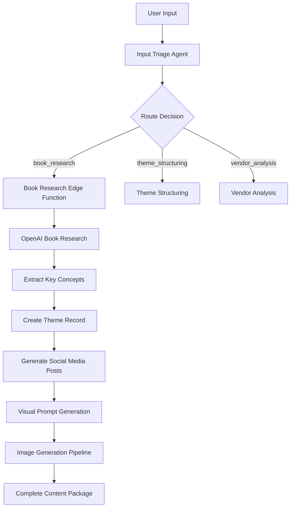

# Book Research to Content Creation Workflow

## Overview

This document describes the complete end-to-end workflow for transforming user book research requests into fully developed social media content packages, including themes, posts, and generated images.

## Architecture Overview



## Detailed Workflow Steps

### Step 1: Input Triage & Classification

**Location**: `supabase/functions/input-triage/index.ts`
**Frontend Hook**: `src/hooks/useInputTriage.ts`

The system uses an AI-powered triage agent to classify user input into three categories:

#### Triage Agent Configuration
- **Agent**: "Triage Orchestra Agent" 
- **Model**: GPT-5 (`gpt-5-2025-08-07`)
- **Purpose**: Intelligently route user requests to appropriate processing pipelines

#### Classification Categories

1. **`book_research`**: User wants to research a book and create content
   - Examples: "Good to Great key concepts", "Atomic Habits main ideas"
   - Routes to: Book Research Edge Function

2. **`theme_structuring`**: User wants to create themed content series
   - Examples: "30-day fitness challenge", "Digital marketing tips"
   - Routes to: Theme Structuring Pipeline

3. **`vendor_analysis`**: User wants to analyze vendors or companies
   - Examples: "Compare CRM tools", "SaaS vendor analysis"
   - Routes to: Vendor Analysis Pipeline

#### Frontend Integration
```typescript
const { determineInputType, isLoading } = useInputTriage();

const handleUserInput = async (input: string) => {
  const result = await determineInputType(input);
  
  switch (result.route) {
    case 'book_research':
      await handleBookResearch(input);
      break;
    case 'theme_structuring':
      await handleThemeStructuring(input);
      break;
    case 'vendor_analysis':
      await handleVendorAnalysis(input);
      break;
  }
};
```

### Step 2: Book Research Processing

**Location**: `supabase/functions/research-book-highlights/index.ts`
**Frontend Hook**: `src/hooks/useBookHighlights.ts`

When input is classified as `book_research`, the system processes it through multiple stages:

#### Stage A: Initial Database Record Creation
```sql
INSERT INTO verified_book_highlights (
  user_id,
  original_input,
  processing_status,
  book_title,
  book_author
) VALUES (?, ?, 'researching', 'Researching...', 'Unknown');
```

#### Stage B: OpenAI Research Call

**Model**: GPT-5 (`gpt-5-2025-08-07`)
**Max Tokens**: 4000
**Temperature**: Default (1.0)

**Research Prompt Structure**:
```
You are a Book Research & Content Creation Agent. For this request: "${user_input}"

Please identify the book and extract the most valuable key concepts, quotes, or principles that would make excellent social media content. Determine the optimal number based on the book's core teachings - some books may have 3-4 major concepts while others might have 8-10 key insights.

Focus on:
1. Core concepts and frameworks from the book
2. Memorable quotes that inspire action
3. Key principles that can be shared as standalone insights
4. Practical takeaways that provide value
```

**Expected JSON Response Format**:
```json
{
  "book_identification": {
    "title": "Book Title",
    "author": "Author Name", 
    "publication_year": 2024,
    "confidence": "high",
    "category": "business"
  },
  "verified_quotes": [
    {
      "quote_text": "The core concept or quote",
      "concept_title": "Short title for this concept",
      "confidence": "high",
      "sources": [{"source_type": "book", "url": "", "title": "Book Title"}],
      "context": "Brief explanation of why this concept matters",
      "social_media_description": "Expanded description suitable for social media post (100-200 words)"
    }
  ],
  "research_metadata": {
    "total_sources_checked": 1,
    "research_confidence": "high", 
    "research_timestamp": "2025-01-25T...",
    "verification_notes": "Book research completed for content creation"
  }
}
```

#### Stage C: Theme Creation

After successful book research, the system automatically creates a theme:

```sql
INSERT INTO themes (
  user_id,
  theme_name,
  description,
  category,
  lifecycle_status,
  prompt_generation_status,
  user_interaction_required,
  background_processing_complete
) VALUES (
  user_id,
  '${book_title} Key Concepts',
  'Key concepts, quotes, and insights from "${book_title}" by ${author}...',
  book_category,
  'ready',
  'not_started',
  false,
  true
);
```

#### Stage D: Social Media Posts Generation

For each concept/quote found in the research, the system creates a social media post:

```sql
INSERT INTO social_media_posts (
  user_id,
  theme_id,
  title,
  description,
  category,
  day,
  status
) VALUES (
  user_id,
  theme_id,
  concept.concept_title,
  concept.social_media_description,
  book_category,
  index + 1,
  'draft'
);
```

#### Stage E: Visual Content Generation

The system then triggers visual content creation for each post:

1. **Visual Prompt Generation**: Calls `visual-prompt-generator` function
2. **Image Generation**: Calls `generate-image-gpt` function for each post
3. **Multi-Aspect Ratio Support**: Generates images in various formats (16:9, 1:1, 9:16, etc.)

#### Stage F: Database Updates

Finally, the system updates all records with the complete results:

```sql
UPDATE verified_book_highlights SET
  book_title = research.book_identification.title,
  book_author = research.book_identification.author,
  verified_quotes = research.verified_quotes,
  verification_confidence = research.research_metadata.research_confidence,
  processing_status = 'completed',
  theme_id = created_theme.id,
  social_posts_created = posts.length
WHERE id = initial_record.id;
```

### Step 3: Frontend Integration & User Experience

#### Book Research Hook Usage
```typescript
const {
  isProcessing,
  processingStatus,
  currentResults,
  userHighlights,
  researchBook,
  fetchUserHighlights,
  deleteHighlight,
  clearCurrentResults
} = useBookHighlights();

// Trigger research
const result = await researchBook("Good to Great key concepts");

// Result includes:
// - Book identification details
// - Extracted concepts/quotes
// - Created theme information
// - Generated social media posts
// - Image generation status
```

#### User Interface States

1. **Processing States**:
   - `"Starting research..."` - Initial setup
   - `"Researching book and quotes..."` - OpenAI analysis
   - `"Creating theme and posts..."` - Content generation
   - `"Generating visuals..."` - Image creation

2. **Success State**:
   - Display complete content package
   - Show created theme with post count
   - Provide access to generated images
   - Enable further editing/customization

3. **Error States**:
   - Research failures with retry options
   - Partial success handling
   - Clear error messaging

## Database Schema Integration

### Core Tables

#### `verified_book_highlights`
- Stores the complete book research results
- Links to created themes and posts
- Tracks processing status and confidence levels

#### `themes`
- Contains the generated theme based on book concepts
- Manages lifecycle status and processing states
- Links to associated social media posts

#### `social_media_posts`
- Individual posts created from each book concept
- Linked to parent theme
- Supports multiple aspect ratio images

#### `openai_agents` & `system_prompts`
- Manages AI agent configurations
- Stores system prompts for different content types
- Enables prompt versioning and optimization

## Error Handling & Resilience

### OpenAI API Failures
- Automatic retry logic with exponential backoff
- Fallback to alternative models if primary fails
- Graceful degradation with partial results

### Database Transaction Management
- Atomic operations for multi-table updates
- Rollback capabilities for failed operations
- Consistency checks and validation

### User Communication
- Real-time status updates via frontend hooks
- Clear error messages with actionable guidance
- Progress indicators for long-running operations

## Performance Optimizations

### Caching Strategy
- Prompt caching via `OptimizedCacheManager`
- Database query optimization
- Reduced API calls through intelligent batching

### Async Processing
- Non-blocking operations for image generation
- Background processing for visual content
- Parallel API calls where possible

### Resource Management
- Rate limiting for external API calls
- Connection pooling for database operations
- Memory-efficient processing of large datasets

## Monitoring & Analytics

### Logging Strategy
- Structured logging via `AdvancedLogger`
- Correlation IDs for request tracking
- Performance metrics and timing

### Success Metrics
- Book research accuracy rates
- Content generation completion rates
- User engagement with generated content

### Error Tracking
- API failure rates and patterns
- Database operation performance
- User experience bottlenecks

## Future Enhancements

### Planned Features
- Multi-language book support
- Custom visual style preferences
- Batch processing for multiple books
- Integration with social media scheduling tools

### Scalability Considerations
- Horizontal scaling for image generation
- Queue-based processing for high-volume requests
- Advanced caching strategies for popular books

## Troubleshooting Guide

### Common Issues

1. **"0 quotes found" Error**
   - Check OpenAI API key configuration
   - Verify book title clarity in user input
   - Review research prompt effectiveness

2. **Theme Creation Failures**
   - Validate user authentication
   - Check database schema compliance
   - Verify category mappings

3. **Image Generation Delays**
   - Monitor external API rate limits
   - Check image generation queue status
   - Validate visual prompt quality

### Debug Resources
- Edge Function logs in Supabase dashboard
- Network request monitoring
- Database query performance analysis